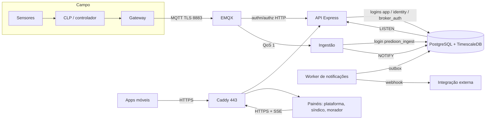

# Auditoria técnica, funcional e comercial — PrédioON

**Data:** 13/11/2026 · **Fonte auditada:** `github.com/helberjf/predioON`, commit `8d50ed5b` (arquivo ZIP do branch padrão) · **Nenhum arquivo do projeto foi alterado** (este relatório é o único arquivo novo).

## Limite desta auditoria (leia antes das notas)

A auditoria teve duas etapas no mesmo dia:

1. **Leitura estática** (API, ingestão, worker de notificações, schema, Compose, Caddy, CI, painéis web), feita antes de haver Node, pnpm ou Docker na máquina.
2. **Execução local**, depois de instalados Node 24.22.1, pnpm 10.17.1, Git e Docker Desktop: instalação de dependências, typecheck, build, auditoria de dependências, as suítes de teste com banco e broker em container descartável, e a reprodução do PON-01. Os resultados estão na seção G.

O que **continua sem execução**: teste de carga, cenários de concorrência B–G em execução dirigida (só os que a suíte do projeto já cobre), restauração de backup, imagens de produção, apps móveis, Firefox/WebKit e qualquer coisa com hardware, broker TLS ou VPS reais. A máquina tem 8 GB de RAM, o que limitou o E2E (ver seção G).

Marcações: **[comprovado]** foi reproduzido em execução por mim. **[rastreado]** foi seguido linha a linha no código, sem reprodução. **[relatado]** vem dos documentos do projeto. **[estimativa]** é cálculo meu com premissas explícitas.

Arquivos criados pela execução, todos locais e fora do versionamento do projeto: `.env` (cópia de `.env.example`), `services/ingest/.env.runtime`, `.local/`, `node_modules/` e as pastas `dist/`. Código alterado apenas na correção do PON-01, depois de autorizada (commit `db1977b5` na `main`).

---

## A. Resumo executivo

O PrédioON é bem mais do que a descrição inicial sugere: um monorepo com API Express, serviço de ingestão MQTT, worker de notificações, três painéis web (plataforma, síndico, morador), dois apps React Native e 67 migrations SQL versionadas com checksum.

**O que está sólido (por leitura de código):**

- **Segurança de identidade acima da média de um MVP.** Argon2id, JWT EdDSA com rotação de chave, refresh token opaco com rotação e detecção de replay, cookie `__Host-` HttpOnly/SameSite=Strict, limitador de login persistido no banco, MFA TOTP, sessões revogáveis.
- **Isolamento entre condomínios feito no banco, não só na aplicação.** RLS em todas as tabelas, autorização por capacidade em funções `SECURITY DEFINER`, e seis logins PostgreSQL restritos (API, identidade, broker, ingestão, acesso físico, notificações) verificados na partida.
- **Ingestão cuidadosa com consistência.** Idempotência por `(condomínio, dispositivo, eventId)` com fingerprint, PUBACK só depois do commit, lock por sensor, alerta e outbox na mesma transação, comando de portão sem retry.

**O que impede uso real hoje:**

1. **Nunca foi validado com hardware, broker TLS, VPS ou e-mail reais** [relatado]. Tudo roda contra simuladores.
2. **O alerta não chega a ninguém sozinho.** Não há e-mail, WhatsApp nem push de alerta; existe apenas um webhook global único que depende de integração externa. Para um produto de monitoramento, este é o valor central.
3. **A esteira de CI não executa** (`startup_failure` em todas as consultas registradas) [relatado]. Localmente as suítes passam (1.874 testes, nenhuma falha — seção G), mas nada impede uma regressão de entrar na `main`.
4. **Backup é um procedimento manual documentado**, sem agendamento, sem RPO/RTO definidos.
5. **Capacidade nunca medida.** A ingestão processa uma mensagem por vez com dezenas de idas ao banco; não há compressão, agregação nem retenção ativa.
6. **Uma mensagem malformada de um único gateway trava a ingestão de todos os condomínios** [comprovado — PON-01, P0]. Reiniciar o serviço não resolvia. **Corrigido e publicado nesta auditoria.**
7. **Sete vulnerabilidades de severidade alta em dependências de produção** (`pnpm audit --prod`), todas com versão corrigida disponível (PON-30).

**Nota ponderada: 6,5 / 10 (Regular).** Não encontrei vazamento de dados entre condomínios, e as suítes de isolamento do projeto passaram em execução. O único P0 comprovado (PON-01) foi corrigido e publicado. Mesmo assim, pelos P1 abertos, o sistema **NÃO ESTÁ APTO PARA PRODUÇÃO**, independentemente da média.

---

## B. Scorecard

| Categoria | Peso | Nota | Base | Justificativa |
|---|---:|---:|---|---|
| Segurança | 15% | 7,0 | Estática + execução | Autenticação e sessões muito bem feitas; suítes de autenticação passaram. Faltam CSP/anti-framing, MFA obrigatória de admin ainda fora da `main`, webhook sem assinatura. `pnpm audit --prod`: 7 altas, 7 moderadas, 3 baixas. |
| Isolamento multi-tenant | 10% | 8,0 | Estática + execução | RLS + capacidades no banco + logins restritos; as suítes de RBAC/RLS do banco e da API passaram. Acoplamento de disponibilidade entre clientes (PON-01). |
| Banco de dados | 10% | 6,5 | Estática + execução | As 67 migrations aplicam em banco limpo e a suíte do banco passou (301/311, 10 pulados). Sem compressão/agregados, retenção desligada, `ingest_events` sem expurgo, 7 índices na hypertable. |
| Concorrência e consistência | 10% | 6,0 | Estática + execução | Idempotência, locks e outbox corretos e cobertos por testes que passaram. **Mensagem-veneno comprovada (P0, corrigida)**, edição last-write-wins, status retido de gateway. |
| Arquitetura | 10% | 7,5 | Estática + execução | Monólito modular bem separado, contratos compartilhados; `check:boundaries` passou. Escopo largo demais para o estágio. |
| Testes e qualidade | 10% | 7,5 | Execução | 1.874 testes passaram localmente, 0 falhas, 11 pulados; typecheck e build limpos. **CI não roda; zero teste de carga; zero hardware; suítes de backup e de cluster isolado não executadas.** |
| Funcionalidades | 8% | 7,0 | Estática | Cobertura ampla. Falta o essencial comercial (canal de alerta, cobrança) e sobra módulo não essencial. |
| Usabilidade e UX | 7% | 6,0 | Estática | Estados de dado antigo/ausente bem tratados. Enums técnicos em inglês na tela, fontes de 10–11 px. **Não vi as telas rodando.** |
| Performance | 5% | 4,0 | Estimativa | Nenhuma medição de carga. Gargalos estruturais identificados na ingestão e no tempo real. |
| DevOps e observabilidade | 5% | 5,0 | Estática | Compose endurecido e health checks reais. Sem backup automático, métricas, alertas operacionais, staging; CI parado. |
| Integração IoT/MQTT | 5% | 6,0 | Estática | ACL por gateway, QoS 1 com ack manual, Last Will, deduplicação. Nunca testado com equipamento real; dependência do relógio do gateway. |
| Prontidão comercial | 5% | 3,5 | Estática | Sem instalação real, sem cobrança, sem contrato/SLA, onboarding manual. |
| **Total ponderado** | 100% | **6,5** | | |

Cálculo: 1,05 + 0,80 + 0,65 + 0,60 + 0,75 + 0,75 + 0,56 + 0,42 + 0,20 + 0,25 + 0,30 + 0,175 = **6,51**.

> **O P0 comprovado (PON-01) foi corrigido; restam P1 abertos. NÃO ESTÁ APTO PARA PRODUÇÃO.** A nota subiu em testes (agora executados) e caiu em segurança e concorrência (achados confirmados); o total ficou praticamente igual.

---

## C. Veredito de prontidão

| Estágio | Veredito | O que impede |
|---|---|---|
| Demonstração | **APTO COM RESTRIÇÕES** | Ambiente local sobe do zero, as 67 migrations aplicam e o smoke E2E abriu as 50 páginas sem erro. Deixar explícito que os dados são simulados; não demonstrar com gateway de terceiros por causa do PON-01. |
| Piloto supervisionado | **NÃO APTO** | PON-01 corrigido (acompanhar `ingest_rejections`); dependências com avisos altos (PON-30); hardware real, broker TLS e VPS nunca validados; alerta sem canal de entrega; backup manual; CI parado; PON-06 aberto. |
| Produção | **NÃO APTO** | Tudo do piloto + observabilidade, RPO/RTO, capacidade medida, MFA obrigatória de admin, LGPD. |
| Comercialização e escala | **NÃO APTO** | Sem cobrança, contrato, SLA, onboarding padronizado; ingestão e armazenamento não escalam além de dezenas de condomínios sem mudanças. |

---

## D. Inventário de funcionalidades

Legenda de estado: **IV** implementada e validada por mim · **IS** implementada, sem validação minha · **P** parcial · **M** só interface/mock · **A** ausente.

| Funcionalidade | Estado | MVP? | Valor | Complexidade restante | Prioridade |
|---|---|---|---|---|---|
| Login, logout, refresh, sessões | IS | Sim | Alto | — | — |
| Recuperação de senha (Resend) | IS (e-mail real não testado) | Sim | Alto | Baixa | Alta |
| MFA TOTP opcional | IS | Não | Médio | — | — |
| MFA obrigatória para admin de plataforma | P (candidata, fora da `main`) | Sim | Alto | Média | Alta |
| RBAC por capacidade, equipes, unidades | IS | Parcial | Alto | — | — |
| Cadastro de organizações/condomínios | IS | Sim | Alto | — | — |
| Cadastro de gateways + emissão de credencial MQTT | IS | Sim | Alto | — | — |
| Cadastro de dispositivos e métricas | IS | Sim | Alto | — | — |
| Ingestão de telemetria MQTT | IS (só simulador) | Sim | Crítico | Média (hardware) | Crítica |
| Leituras atuais e séries históricas | IS | Sim | Alto | Baixa (limites) | Alta |
| Regras de alerta configuráveis + padrões | IS | Sim | Alto | — | — |
| Alertas: reconhecer / resolver | IS | Sim | Alto | — | — |
| Detecção de offline (timeout + Last Will) | IS | Sim | Alto | Baixa | Alta |
| **Entrega de alerta (e-mail/WhatsApp/push)** | **A** (só webhook global) | **Sim** | **Crítico** | Média | **Crítica** |
| Tempo real (SSE) | IS | Desejável | Médio | Média (escala) | Média |
| Dashboard multi-condomínio (plataforma) | IS | Sim | Alto | — | — |
| Dashboard do síndico | IS | Sim | Alto | Baixa (UX) | Alta |
| Consumo de água/energia + anomalia estatística | IS | Não | Médio | — | Adiar |
| Audit log | IS | Sim | Médio | — | — |
| Ocorrências / chamados | IS | Não | Médio | — | Manter simples |
| Ordens de serviço, ativos, automações | IS | Não | Médio | — | Adiar |
| Avisos, reservas de áreas comuns | IS | Não | Médio | — | Adiar |
| Controle de portão (comando/ACK), QR de totem | IS (só simulador) | **Não** | Médio | Alta (risco físico) | **Desligar no piloto** |
| Vagas de estacionamento | IS | Não | Baixo | — | Adiar |
| Prestação de contas (financeiro) | IS | Não | Baixo | — | Adiar |
| Suporte remoto (registro AnyDesk) | IS | Não | Baixo | — | Adiar |
| Relatórios exportáveis (PDF/CSV) | A | Desejável | Médio | Baixa | Média |
| Painel de saúde operacional da plataforma | P (migration 058) | Sim | Alto | Média | Alta |
| Provisionamento/onboarding padronizado | P (manual de 600+ linhas) | Sim | Alto | Média | Alta |
| Planos e cobrança recorrente | A | Para vender | Alto | Média | Fase 3 |
| Apps móveis (morador, operação) | P (iOS assinado pendente) | Não | Médio | Alta | Adiar |
| Exclusão/anonimização de titular (LGPD) | A | Para vender | Alto | Média | Fase 3 |

**Recomendação de escopo:** o MVP vendável é *água + bomba + falha de fase + vazamento + offline + alerta que chega no celular do síndico*. Reservas, financeiro, vagas, portão, totem e dois apps nativos consomem a maior parte do esforço de teste registrado e não ajudam a fechar o primeiro contrato.

---

## E. Problemas P0 e P1

**P0: um comprovado — PON-01, já corrigido e publicado.**

### PON-01 — Mensagem-veneno trava a ingestão de todos os condomínios · P0 · Concorrência/Disponibilidade · [comprovado] · **CORRIGIDO**

- **Reprodução executada em 13/11/2026** (serviço de ingestão real, EMQX e TimescaleDB em container local, dados do seed):
  1. Leitura válida de `temp_01` → gravada em menos de 4 s.
  2. Leitura de `temp_01` com `eventId` contendo `\u0000` → o serviço registrou "Persistência MQTT falhou; aguardando reentrega" e reconectou em laço: 14 falhas em 25 s, 20 em cerca de 1 min.
  3. Leitura válida de **outro** sensor (`energy_01`), publicada depois → **não foi gravada** em nenhum momento do ensaio.
  4. Serviço encerrado e reiniciado → o laço recomeçou (6 falhas em 30 s) e a leitura do passo 3 continuou sem ser gravada. A saída só veio ao descartar a sessão no broker.
  - O registro de saúde da ingestão mostrou `mqtt:false` nas três amostras colhidas durante o laço. Ou seja, o health check tende a acusar o problema, mas reiniciar o container não o resolve.
  - O ensaio usou um único condomínio. Como todas as mensagens passam pela mesma fila e pela mesma sessão MQTT, o bloqueio vale para todos; isso segue do código (`mqtt.ts:41`), não foi ensaiado com dois condomínios.
  - Em separado, confirmei que `normalizeTelemetry` aceita `\u0000` em `eventId`, `value`, `metric` e `unit`.
- **Arquivos:** `packages/shared/src/telemetry.ts:14-23`, `services/ingest/src/pipeline/telemetry.ts:72-98`, `services/ingest/src/mqtt.ts:41-65`.
- **Evidência:** o schema aceita qualquer string em `eventId`, `metric`, `unit` e `value` (até 500 caracteres), inclusive o caractere `\u0000`. O PostgreSQL rejeita `\u0000` em `text` e em `jsonb`. O `INSERT` lança erro; o handler destrói a conexão e **não confirma** a mensagem (`mqtt.ts:58-65`). Com sessão persistente, o broker reentrega a mesma mensagem; ela falha de novo. Como todas as mensagens passam por uma única fila serial (`mqtt.ts:41`), nada depois dela é processado.
- **Cenário seguro de reprodução:** em ambiente local, com um gateway cadastrado, publicar no tópico de um sensor dele um envelope válido com `"eventId":"abc\u0000defgh"`. Observar reconexões em laço e a telemetria de outros condomínios parada.
- **Impacto:** um firmware com defeito (ou um gateway comprometido) de **um** cliente derruba o monitoramento de **todos**, sem alerta para ninguém, até intervenção manual no broker.
- **Causa-raiz:** todo erro de banco é tratado como transitório; não há distinção entre "tente de novo" e "esta mensagem nunca vai entrar".
- **Outros vetores encontrados:**
  - **Surrogate isolado (comprovado):** um `value` de texto com surrogate isolado (`"\ud800"`) passa no schema — há inclusive um teste do projeto que garante isso (`normalize-utf8.test.ts`, "does not broaden byte validation…") — e o JSONB do PostgreSQL o recusa (SQLSTATE `22P02`). Confirmei o comportamento do PostgreSQL diretamente no banco. Por isso a correção não pode se limitar ao caractere nulo.
  - **Versão de firmware (rastreado):** `firmwareVersion` no status do gateway (`gateway-status.ts:36-41`) é gravado em coluna `text` e tinha o mesmo problema.

**Status: CORRIGIDO NESTA AUDITORIA, com autorização do responsável, e publicado na `main` no mesmo commit deste relatório.** A correção tem duas camadas:

1. **Validação** (`packages/shared/src/telemetry.ts`): `eventId`, `buildingId`, `deviceId`, `metric`, `unit`, `value` (texto) e `firmwareVersion` recusam `U+0000`. O envelope é contado como `INVALID_ENVELOPE` antes de qualquer escrita. Outros caracteres de controle continuam aceitos, porque o PostgreSQL os grava.
2. **Classificação do erro** (`services/ingest/src/permanent-error.ts`, novo): erro do PostgreSQL da classe `22` ("data exception") é tratado como recusa definitiva. A cadeia `cause` é percorrida, porque o Drizzle embrulha o erro do driver.
   - Em `pipeline/telemetry.ts`, a transação é desfeita, a mensagem é contada como `INVALID_ENVELOPE` e a função retorna normalmente, então o broker recebe o PUBACK.
   - Em `mqtt.ts`, uma rede de segurança faz o mesmo para os demais tópicos (status, ack), sem derrubar a sessão.
   - Falhas transitórias continuam sem confirmação e voltam a ser entregues: conexão, deadlock (`40P01`), serialização (`40001`), permissão (`42501`), unicidade (`23505`). Foi escolhida só a classe `22`, e não a `23`, porque uma violação de chave estrangeira pode vir de uma corrida com exclusão de dispositivo.

**Verificação da correção:**

| Prova | Resultado |
|---|---|
| 11 testes novos (`poison-message.test.ts`; 2 em `mqtt-delivery.test.ts` com broker Aedes real; 1 em `pipeline.test.ts` com banco real e login restrito) | Passam |
| Os mesmos testes contra o código original | 7 falham, como esperado (os do classificador não dependem do código antigo) |
| Suíte da ingestão inteira com a correção | 210 / 210 |
| Ensaio de ponta a ponta repetido (EMQX + serviço real): leitura válida, nulo no `eventId`, surrogate no `value`, leitura de outro sensor | As 2 válidas gravadas; as 2 inválidas recusadas e contadas (`INVALID_ENVELOPE` 36 → 38); **0 reconexões, 0 falhas de persistência** |
| Regressão completa em cluster novo, TimescaleDB 2.30.1 | Ver seção G |

**Risco que sobra:**

- Um erro determinístico **fora** da classe `22` (por exemplo, a verificação `assertPersisted` divergindo por causa de um trigger) ainda reentregaria em laço.
- Se um defeito do próprio código passar a produzir erros da classe `22`, as mensagens afetadas serão descartadas e contadas, em vez de travar a fila. É a troca certa para monitoramento multi-cliente, mas exige vigiar `ingest_rejections`.
- Recomendação para a Fase 2: limite de reentregas por mensagem, com registro do descarte (fila de mensagens mortas), e alerta operacional quando `INVALID_ENVELOPE` crescer.

- **Esforço:** baixo (feito: 3 arquivos alterados, 1 novo, 3 arquivos de teste).

### PON-02 — Alertas não têm canal de entrega próprio · P1 · Funcionalidade/Comercial

- **Arquivos:** `README.md:91`, `infrastructure/docker-compose.prod.yml:192`, `services/notifications/src/transport.ts:27-57`.
- **Evidência:** o worker envia `POST` para **uma** URL global (`ALERT_WEBHOOK_URL`), só para HIGH/CRITICAL. Sem URL, o evento termina como `no_destination` e não é reenviado depois. Não há e-mail de alerta, WhatsApp nem push.
- **Impacto:** um reservatório vazio às 3h só é visto se alguém estiver com o painel aberto. Não há destinatário por condomínio.
- **Correção:** destinatários por condomínio (síndico, zelador) com pelo menos e-mail (Resend já integrado) e um canal móvel (WhatsApp via provedor ou push). Reaproveitar a outbox existente.
- **Teste de aceite:** alerta CRITICAL simulado chega ao e-mail e ao celular de dois destinatários de um condomínio, e não chega a destinatários de outro.
- **Esforço:** médio.

### PON-03 — Nenhuma validação com equipamento e infraestrutura reais · P1 · IoT/Operação · [relatado]

- **Arquivos:** `docs/CONTINUIDADE.md:110` ("VPS/TLS/e-mail/hardware reais" em aberto), `docs/NEXT_STEPS.md:14-22`.
- **Impacto:** contrato de payload, relógio, reconexão, Last Will, QoS e certificado TLS do broker nunca foram exercitados por um gateway de verdade.
- **Correção:** bancada com um gateway e 3–4 sensores reais publicando em uma VPS de homologação por duas semanas, com roteiro de queda de energia, queda de internet e reinício de cada serviço.
- **Esforço:** alto (depende de hardware).

### PON-04 — CI não executa · P1 · Qualidade · [relatado; as suítes passam localmente — seção G]

- **Arquivos:** `docs/CONTINUIDADE.md:118-128` (cinco execuções com `startup_failure`, zero jobs), `.github/workflows/ci.yml`.
- **Impacto:** as centenas de testes só rodam na máquina do desenvolvedor. Uma regressão entra na `main` sem aviso.
- **Correção:** resolver a causa do `startup_failure` (o próprio registro aponta cobrança/limite da conta como hipótese histórica) e exigir CI verde para merge.
- **Esforço:** baixo.

### PON-05 — Backup manual, sem RPO/RTO · P1 · DevOps

- **Arquivos:** `docs/DEPLOY.md:188`, `docs/PRD.md:333` ("Planejado"), `infrastructure/docker-compose.prod.yml:261-265` (volume único `pg_data`).
- **Evidência:** existe teste de restauração (`packages/db/test/backup-restore.test.ts`) e procedimento manual com `pg_dump`. Não há job agendado, cópia externa automática nem WAL archiving.
- **Impacto:** perda do disco da VPS = perda de todo o histórico de todos os clientes.
- **Correção:** `pg_dump` diário cifrado para armazenamento externo + ensaio mensal de restauração. Para RPO de 15 min (meta do PRD), WAL archiving (pgBackRest ou wal-g).
- **Esforço:** baixo (dump diário) / médio (WAL).

### PON-06 — O sistema confia no relógio do gateway · P1 · IoT/Consistência · [rastreado]

- **Arquivos:** `services/ingest/src/pipeline/telemetry.ts:45`, `services/ingest/src/rules/evaluate.ts:10,31`, `services/ingest/src/analytics/usage.ts:58`.
- **Evidência:**
  - Leitura com timestamp mais de 60 s **no futuro**: o envelope inteiro é contado como `FUTURE_TIMESTAMP`, **confirmado ao broker e perdido** — sem identificar o condomínio.
  - Leitura com timestamp mais de 5 min **no passado**: é gravada, mas **nenhuma regra de alerta é avaliada**.
- **Impacto:** um gateway sem NTP, com relógio 6 minutos atrasado, aparece ONLINE, mostra leituras, e **nunca dispara alerta**. Falha silenciosa do tipo mais perigoso para o produto.
- **Correção:** medir `received_at − time` por dispositivo; abrir alerta `CLOCK_SKEW` acima de um limiar; registrar o condomínio na rejeição; considerar avaliar regras pelo horário de recebimento quando o desvio for constante.
- **Teste de aceite:** simulador com relógio −10 min gera alerta de desvio em até 2 ciclos.
- **Esforço:** baixo.

### PON-07 — O broker consulta a API a cada publicação · P1 · Confiabilidade · [rastreado; comportamento do EMQX a confirmar em ensaio]

- **Arquivos:** `infrastructure/docker-compose.prod.yml:53-63` (`AUTHORIZATION__CACHE__ENABLE: "false"`, `NO_MATCH: deny`), `apps/api/src/modules/mqtt/routes.ts:68-95`, comentário em `services/ingest/src/mqtt.ts:18-19`.
- **Evidência:** cada `PUBLISH` de gateway gera um `POST /internal/mqtt/authz` e duas consultas ao banco. Se a API estiver reiniciando, a autorização falha e a regra final é negar.
- **Impacto:** durante um deploy ou queda da API, leituras podem ser descartadas no broker antes de chegar à ingestão; em MQTT 3.1.1 o gateway não é avisado. Além disso, dobra a carga de banco por mensagem.
- **Correção:** ligar o cache de autorização com TTL curto (30–60 s), ou trocar para ACL por padrão de tópico derivada do usuário (`predio/${buildingId}/...`) emitida na autenticação.
- **Teste de aceite:** parar a API por 60 s com um gateway publicando QoS 1; zero leituras perdidas após a volta.
- **Esforço:** baixo.

### PON-08 — Ingestão serial e tempo real com custo N×M · P1 em escala · Performance · [ingestão medida; SSE estimado]

- **Medição (13/11/2026):**
  - **Topologia:** imagem de produção da ingestão (`NODE_ENV=production`, logins restritos) e EMQX 6.3.1 com sessões duráveis, na mesma rede Docker do TimescaleDB.
  - **Máquina:** notebook de 8 GB e 12 CPUs lógicas, com outros containers ligados.
  - **Teto: 22–24 mensagens/s, constante** com 50, 100 ou 200 msg/s oferecidas.
  - **Abaixo do teto** (10 msg/s): latência mediana de 28 ms, p95 de 37 ms e máximo de 62 ms.
  - **Saturado:** a ingestão usou 42% de um núcleo e o banco 49%. O limite é a fila serial (cerca de 40 ms de idas ao banco por mensagem), não a CPU. Uma VPS mais rápida melhora pouco; só o processamento em paralelo muda a ordem de grandeza.
  - **Perda:** nenhuma. 12.200 mensagens gravadas no total, 0 descartes, 0 erros. Acima do teto a fila cresce e a latência chegou a 2 min.

- **Arquivos:** `services/ingest/src/mqtt.ts:41-53`, `services/ingest/src/pipeline/telemetry.ts:47-146`, `services/ingest/src/realtime.ts:11-30`, `apps/api/src/modules/events/routes.ts:38-79`, `packages/db/src/context.ts:11` (pool de 10).
- **Evidência:** uma mensagem por vez, cada uma com ~25 idas ao banco na transação principal (cada escrita é relida duas a três vezes por `assertPersisted`) e mais ~7 na publicação em tempo real. No lado da API, **cada evento, para cada painel aberto**, refaz a identidade (2 consultas) e abre uma transação de projeção.
- **Impacto:** a estimativa estática (50–100 msg/s) era otimista; o medido é **~22 msg/s**. Com 20 sensores por condomínio e uma reserva de 50%:
  - leitura a cada 60 s: cerca de 30 condomínios;
  - a cada 30 s: cerca de 15;
  - a cada 5 s: 2 a 3.

  Basta para o piloto; não basta para 100 condomínios em nenhum intervalo. Com 100 painéis abertos e 60 eventos/s, a API precisaria de milhares de transações/s em um pool de 10 conexões; a fila por assinante passa de 100 e a conexão é encerrada (`routes.ts:41`), gerando laço de reconexão.
- **Correção (só quando a medição pedir):** paralelizar por dispositivo (N filas por hash de `deviceId`); reduzir releituras a uma verificação no fim da transação; no SSE, cachear a autorização por assinante por alguns segundos e filtrar por `buildingId` antes de consultar o banco.
- **Teste de aceite:** teste de carga com publicador sintético a 100, 400 e 1.000 msg/s medindo atraso fim-a-fim.
- **Esforço:** médio.

### PON-09 — Armazenamento cresce sem limite · P1 em escala · Banco

- **Arquivos:** `infrastructure/056-telemetry-series-catalog.sql:13-14`, `infrastructure/001-timescale-rls.sql:23-30` (políticas comentadas), `packages/db/src/telemetry-retention.ts` (CLI manual), `packages/db/src/schema.ts:185-204`.
- **Evidência:** compressão e continuous aggregates não são usados porque o TimescaleDB 2.17 os recusa em tabelas com RLS. Retenção existe só como comando manual (mínimo 13 meses). `ingest_events` recebe **uma linha por leitura para sempre** e não tem expurgo em lugar nenhum do código.
- **Impacto:** ver seção F.10. A 100 condomínios × 20 sensores × 30 s são ~1 TiB/ano só de telemetria.
- **Correção:** (1) expurgo de `ingest_events` após N dias (a janela de deduplicação não precisa passar de 7–30 dias); (2) tabela de agregados horários/diários sem RLS própria, lida por função `SECURITY DEFINER`; (3) reavaliar compressão na versão de produção (2.30.1), que é diferente da usada nos testes; (4) retenção padrão ligada.
- **Esforço:** médio.

### PON-10 — MFA obrigatória do administrador de plataforma não está em produção · P1 · Segurança · [relatado]

- **Arquivos:** `README.md:83`, `docs/CONTINUIDADE.md:29`.
- **Impacto:** a conta que enxerga todos os condomínios é protegida só por senha, a menos que o próprio usuário ative o TOTP.
- **Correção:** concluir a integração candidata antes de qualquer cliente real.
- **Esforço:** médio (trabalho já avançado).

---

### PON-30 — Dependências de produção com vulnerabilidades conhecidas · P1 · Segurança · [comprovado por `pnpm audit --prod`]

- **Evidência:** 17 avisos em dependências de produção (7 altos, 7 moderados, 3 baixos); 21 contando as de desenvolvimento. Os altos:

| Pacote | Aviso | Corrigido em | Entra por | Alcançável no PrédioON? |
|---|---|---|---|---|
| `body-parser` | Negação de serviço com bytes após corpo comprimido (GHSA-27r3-jxmh-p828) | ≥ 2.4.0 | `express` na API | Provável: a API é pública e usa o parser de corpo. Não ensaiei. |
| `zod` | Esgotamento de memória ao validar coleções grandes com restrição (GHSA-mrhx-c7xc-m3w5) | ≥ 4.6.6 | API e pacotes compartilhados | Limitado pelo teto de tamanho do corpo; não ensaiei. |
| `drizzle-orm` | Injeção de SQL por identificadores mal escapados (GHSA-gpj5-g38j-94v9) | ≥ 0.45.2 | API, ingestão, banco | Não encontrei identificador SQL montado com entrada do usuário (busca por `sql.identifier`, `sql.raw` e `.unsafe(`: só migrations com texto fixo). Atualizar mesmo assim. |
| `joi`, `launch-editor` | Negação de serviço; verificação de arquivo contornável no Windows | ≥ 17.13.9; ≥ 2.14.2 | `react-native` (ferramentas do app) | Não: ferramenta de desenvolvimento, não vai para o servidor. |
| `vite`, `source-map-js` | Idem `launch-editor`; negação de serviço em source maps | ≥ 7.3.7; ≥ 1.2.2 | `@vitejs/plugin-react` | Só em build e desenvolvimento. Atenção: o Compose de produção serve os portais por imagem própria (PON-19); conferir que o servidor de desenvolvimento do Vite nunca fica exposto. |

- **Moderados relevantes ao servidor:** `qs` (via `express`) e `ip-address` (via `mqtt`, na ingestão), ambos negação de serviço.
- **Impacto:** exposição a negação de serviço na API pública com falhas já divulgadas.
- **Correção:** atualizar `express`/`body-parser`, `zod`, `drizzle-orm`, `mqtt` e `vite`; rodar as suítes; acrescentar `pnpm audit --prod --audit-level high` ao CI.
- **Teste de aceite:** `pnpm audit --prod` sem avisos altos; suítes da seção G continuam passando.
- **Esforço:** baixo a médio (o salto de `drizzle-orm` 0.44 → 0.45 e o de `zod` pedem revisão das suítes).

---

## F. Auditoria técnica detalhada

### F.1 Mapa da aplicação

| Módulo | Responsabilidade | Depende de |
|---|---|---|
| `apps/api` | Express 5. Autenticação, autorização, ~190 rotas em 33 módulos, SSE, autorização do broker | `packages/db`, `shared`, `contracts` |
| `services/ingest` | Assina MQTT, valida, deduplica, grava, avalia regras, detecta offline, despacha comandos de portão, simuladores | `packages/db/ingest`, `shared` |
| `services/notifications` | Worker da outbox → webhook HTTP | `packages/db/notifications` |
| `packages/db` | Schema Drizzle, baseline, runner de migrations com checksum, provisionamento de logins restritos, seed | PostgreSQL 16 + TimescaleDB |
| `packages/shared` | Schemas Zod de telemetria, tópicos, RBAC, features, sensores | — |
| `packages/contracts`, `api-client` | DTOs e cliente HTTP com sessão | `shared` |
| `packages/ui` | Componentes, sessão web, SSE, estados | `api-client` |
| `apps/admin-web`, `building-web`, `resident-web` | Painéis React 19 + Vite + Tailwind | `packages/ui` |
| `apps/*-mobile`, `packages/mobile` | React Native (sem Expo) | `api-client` |
| `infrastructure/` | Compose (dev, demo, prod), Caddy, 67 SQL, scripts de setup | — |

**Pontos de entrada externos:** HTTPS 443 (Caddy → API e painéis), MQTT TLS 8883 (EMQX). `/internal/*` é bloqueado no Caddy (`Caddyfile:16-17`) e protegido por segredo compartilhado.

**Diferenças em relação ao contexto fornecido:** não há shadcn/ui (componentes próprios); há Caddy, worker de notificações, três painéis e dois apps que o contexto não menciona.

### F.2 Segurança

**Autenticação e sessão — pontos verificados no código**

| Item | Situação | Onde |
|---|---|---|
| Hash de senha | Argon2id, com comparação fictícia para conta inexistente | `auth/passwords.ts:4-32` |
| Access token | JWT EdDSA, 5 min, `kid` obrigatório, algoritmo fixo | `auth/tokens.ts:41-62` |
| Revogação imediata | Cada requisição confere sessão e conta no banco | `auth/service.ts:54-60` |
| Refresh | Opaco (48 bytes), só o SHA-256 é gravado, rotação com detecção de replay que revoga a família | `auth/service.ts:95-153` |
| Cookie web | `__Host-`, HttpOnly, Secure, SameSite=Strict, por origem | `auth/web-routes.ts:18-33` |
| CSRF | Origin exata + cabeçalho próprio + JSON obrigatório; rotas de domínio só aceitam Bearer | `auth/web-routes.ts:18-53` |
| Força bruta | Orçamento por rede e por conta em função SQL; falha fechada | `auth/login-budget.ts:9-37` |
| Enumeração de contas | Recuperação sempre responde 204 e processa depois da resposta | `auth/recovery.ts:48-72` |
| Token de recuperação | 32 bytes, uso único, 60 min, enviado no fragmento da URL | `auth/recovery.ts:58-62` |
| CORS | Lista explícita de origens | `app.ts:46`, `config.ts:73` |
| Proxy confiável | Só o IP /32 do Caddy | `docker-compose.prod.yml:117` |
| Segredos | Nenhum valor real no repositório; `.env.prod.example` com campos vazios; erros de driver suprimidos para não vazar DSN | vários |
| SQL injection | Consultas parametrizadas; `unsafe()` só no runner de migrations com arquivos do repositório | `packages/db/src/*` |
| XSS | Nenhum `dangerouslySetInnerHTML`/`innerHTML` nos painéis | busca em `apps/*-web`, `packages/ui` |
| Armazenamento no navegador | Access token em memória; `localStorage` guarda só época de sessão e avisos lidos | `ui/web-session-coordinator.ts:122-128` |

**Achados de segurança (P2/P3)**

| ID | Sev. | Achado | Onde | Correção |
|---|---|---|---|---|
| PON-15 | P2 | Sem `Content-Security-Policy`, sem `frame-ancestors`/`X-Frame-Options`, sem `Referrer-Policy`. A API não usa `helmet`. Painéis podem ser embutidos em iframe (clickjacking). | `Caddyfile:30-34,44-48,57-61,70-74` | Adicionar os três cabeçalhos nos quatro blocos. |
| PON-16 | P2 | Webhook de alerta sem assinatura: o receptor não consegue provar que a chamada veio do PrédioON. | `notifications/src/transport.ts:40-44` | Cabeçalho HMAC-SHA256 do corpo com segredo por destino. |
| PON-23 | P2 | LGPD: não existe rota para excluir ou anonimizar um usuário (só remover vínculo); IP e user-agent ficam em `sessions`, `refresh_tokens` e `audit_logs` sem prazo. | `modules/users/routes.ts:67-160` | Fluxo de exclusão/anonimização + expurgo de sessões expiradas + política de retenção escrita. |
| PON-25 | P3 | A rota SSE ainda aceita `?access_token=` embora o cliente web use cabeçalho. Token em URL acaba em logs e histórico. | `modules/events/routes.ts:20-21` | Remover o parâmetro. |
| PON-26 | P3 | As políticas RLS originais confiam em `app.role`, variável definida pela aplicação. As funções novas (014) ignoram essa variável de propósito. Hoje o valor vem do banco a cada requisição; é defesa em profundidade. | `001-timescale-rls.sql:41-47` vs `014-rbac-tenancy.sql:249-250` | Confirmar se alguma política ativa ainda depende de `app_is_platform_admin()` e migrar para `app_rbac_platform_role`. |
| — | — | Auditoria de dependências (`pnpm audit`) | — | **Não executada** (sem Node). Versões usam `^`; o lockfile fixa. |

**Isolamento entre condomínios.** Não encontrei caminho de leitura ou escrita cruzada por leitura de código:

- Toda rota autenticada roda dentro de `withUserContext` (`packages/db/src/context.ts:30-41`); esquecer um `WHERE building_id` devolve zero linhas.
- O login da API não é dono das tabelas e é verificado na partida (sem superuser, sem `BYPASSRLS`, sem herança) — `runtime-connection.ts:46-68`.
- O SSE reautoriza cada evento contra o banco antes de escrever no stream (`events/routes.ts:42-79`).
- O broker só deixa o gateway publicar em sensores dele (`mqtt/routes.ts:78-93`); a ingestão confere de novo tópico × payload × cadastro (`normalize.ts:34`, `telemetry.ts:54-66`).
- Existe spec E2E dedicada (`e2e/specs/tenancy/isolation.spec.ts`) e testes de RLS com o login restrito (`apps/api/test/rbac-db.integration.test.ts`). **Não os executei.**

Único acoplamento entre clientes encontrado: disponibilidade (PON-01).

### F.3 Banco de dados

**Modelagem — bom:** FKs compostas `(id, building_id)` impedem ligar unidade/equipe de um condomínio a outro (`014:16,31,49,79`); `CHECK` de janelas de tempo; exclusão de reserva dupla por *exclusion constraint* (`schema.ts:482-485`); trilha de auditoria somente-inserção (`014:441`); migrations com ledger e checksum que recusam histórico alterado (`migration-runner.ts:17-18`).

| ID | Sev. | Achado | Onde | Correção |
|---|---|---|---|---|
| PON-09 | P1 | Sem compressão, agregados ou retenção ativa; `ingest_events` sem expurgo | ver seção E | — |
| PON-20 | P2 | Sete índices na hypertable, dois redundantes (`building_id,time` e `building_id,time DESC`); `metric,time` e `event_id` de uso duvidoso. O próprio projeto mediu ~23 bytes/leitura só nos duplicados. | `001:16-21`, `schema.ts:231-233`, `docs/DATABASE_MODEL.md:60` | Remover os redundantes após `pg_stat_user_indexes` em carga real. |
| PON-17 | P2 | Testes rodam em TimescaleDB **2.17.2**; produção usa **2.30.1**. A decisão de não comprimir foi tomada na versão antiga. | `ci.yml:22`, `docker-compose.prod.yml:20` | Mesma imagem nos dois. |
| PON-13 | P2 | `/telemetry/series` não limita a janela nem valida `from < to`. Um pedido de 1 ano em baldes de 1 min devolve ~525 mil linhas. | `modules/telemetry/routes.ts:25-31,96-124` | Limitar o número de baldes (ex.: 2.000) e escolher o balde pelo intervalo. |
| PON-14 | P2 | `/alerts` pagina **antes** de filtrar por permissão e faz uma consulta de autorização por alerta (até 200). Páginas podem vir incompletas sem indicar fim. | `modules/alerts/routes.ts:27-37` | Filtrar na consulta (função set-returning) ou devolver `nextOffset`. |
| PON-29 | P3 | Identificadores mistos: `text` gerado pela aplicação em condomínios/gateways/dispositivos, `uuid` no restante. | `schema.ts:28,44,58,104,130` | Aceitar; documentar. |
| — | P3 | `telemetry.device_id` tem `ON DELETE CASCADE`: apagar um dispositivo apaga o histórico. Hoje não há rota de exclusão. | `schema.ts:218-220` | Manter só desativação. |

**Timezones:** todas as colunas são `timestamptz`; horário do dispositivo (`time`) e de recebimento (`received_at`) são guardados separados (`schema.ts:226-227`) — correto. O condomínio tem `timezone` próprio usado nos cortes diários.

### F.4 Concorrência — ver seção H

### F.5 Arquitetura — ver seção I

### F.6 MQTT e IoT

| Item | Situação | Onde |
|---|---|---|
| Tópicos | `predio/{building}/device/{device}/telemetry`, `.../caixa_agua/{device}/telemetria`, `.../gateway/{gw}/status`, acesso `command`/`ack` | `shared/src/topics.ts` |
| Autenticação | Usuário `gw_{id}` + senha aleatória de 24 bytes mostrada uma vez, hash Argon2; `clientid` deve ser o id do gateway | `gateways/routes.ts:108-155`, `mqtt/routes.ts:41-49` |
| ACL | Por gateway e por sensor cadastrado; arquivo de fallback nega tudo | `mqtt/routes.ts:68-95`, `emqx/acl.conf` |
| TLS | 8883 com TLS 1.2/1.3; WS/WSS desligados; ingestão fala com o broker em texto claro na rede interna do Compose | `docker-compose.prod.yml:45,64-68,158` |
| QoS / ack | QoS 1, PUBACK só após commit | `mqtt.ts:38-65` |
| Sessão | Persistente no cliente e durável no broker | `mqtt.ts:15`, `docker-compose.prod.yml:50` |
| Last Will | Tratado como desconexão confirmada | `gateway-status.ts:30-33`, `offline-sweeper.ts:94-96` |
| Retained em telemetria | Guardado como histórico, sem heartbeat nem alerta | `telemetry.ts:106,119` |
| Versão do payload | `schemaVersion: 1` no envelope genérico; **ausente** no payload de caixa d'água (PON-28, P3) | `shared/src/telemetry.ts:15,41-48` |
| Faixa válida | Limites por métrica no schema; qualidade GOOD/UNCERTAIN/BAD; regra só avalia GOOD | `shared/src/sensors.ts:11-32`, `telemetry.ts:110` |
| Offline | Varredura a cada 30 s; gateway 180 s, sensor 600 s em produção | `offline-sweeper.ts:68-86`, `docker-compose.prod.yml:162-163` |
| mTLS por dispositivo | Não implementado (previsto como evolução) | `docs/NEXT_STEPS.md:34` |

**Comandos remotos (portão):** existem e são tratados com cuidado — pedido expira, não há retry, não fica em fila offline, só o ACK correlacionado confirma, falha de publicação registra FAILED (`access/dispatcher.ts:40-84`). O README declara que o ACK não mede a posição física e que fumaça/gás não substituem equipamento certificado (`README.md:67,90`). **Recomendo manter o módulo de acesso físico desligado no piloto de monitoramento** (as migrations 049/050 já o deixam como opt-in).

**Segurança física:** não encontrei nenhuma lógica de proteção (intertravamento de bomba, corte por nível) no software de nuvem — correto. Isso deve ficar no CLP/quadro, com projeto de profissional habilitado.

### F.7 Testes

Existência e qualidade (estático):

| Pacote | Arquivos de teste | Observação |
|---|---:|---|
| `apps/api/test` | ~80 | Autorização por capacidade, janelas de tempo, sessões, throttling, RLS com login restrito; usa triggers adversariais para provar rollback. |
| `services/ingest/test` | ~25 | Pipeline, entrega MQTT, outbox, UTF-8 inválido, política de recibo. |
| `services/notifications/test` | 4 | Lease, protocolo, falha de conexão. |
| `packages/db/test` | ~21 | Migrations, ACL, backup/restauração entre clusters. |
| `packages/ui`, `api-client`, `mobile` | ~55 | Estados, sessão, clientes. |
| `e2e/` (Playwright + axe) | ~40 specs | Auth, isolamento, permissões por papel, monitoramento, acessibilidade de foco. |

Lacunas:

- Sem teste de carga no projeto (fiz um, seção F.10).
- Sem teste com broker e gateway reais.
- 33 pontos de `skip` condicionais em 23 arquivos, que dependem de variáveis de ambiente ("pulados não são evidência", como o próprio README diz).
- Nenhum teste cobria caractere nulo nem surrogate isolado no envelope (PON-01; os testes que escrevi cobrem).
- Os testes de UI cobrem lógica de estado, não renderização.

**PON-31 · P3 · Qualidade · [comprovado] — A suíte da API depende de estado limpo deixado pelas outras suítes.**

- **Teste afetado:** "alert delivery serializes with pause and old alerts are not delivered afterwards" (`apps/api/test/features-lifecycle.test.ts:156-195`). Ele supõe que o único evento pendente na outbox é o dele.
- **Origem da sujeira:** as suítes integradas da ingestão deixaram **48 entregas pendentes** no banco (condomínios de fixture `npb_*`, criadas às 12h42).
- **Efeito:** com o banco nesse estado, o worker do teste entrega primeiro um alerta antigo e o teste falha de forma reproduzível: espera `delivered` e recebe `cancelled`.
- **Por que não aparece no CI:** lá a API roda antes da ingestão e cada job recebe um banco novo.
- **Impacto:** nenhum no produto. Um desenvolvedor que rode as suítes fora da ordem recebe uma falha falsa.
- **Correção:** o teste filtrar o worker pelo próprio evento (ou limpar a outbox na preparação) e as suítes da ingestão apagarem suas linhas de outbox ao terminar.

**PON-32 · P3 · Qualidade · [comprovado] — Teste intermitente no contrato SQL038.**

- **Teste afetado:** "refuses lock-only access and rollback-contaminated connections" (`packages/db/test/notification-delivery.test.ts:344-356`).
- **Resultado:** falhou 1 vez em 4 execuções em clusters novos, com `1 !== 0` na linha 355.
- **Causa:** logo após `client.end({ timeout: 0 })`, o teste verifica em `pg_locks` que o lock consultivo da conexão sumiu. O PostgreSQL só libera esse lock quando o processo da conexão percebe o socket fechado, e isso é assíncrono. Em máquina lenta a verificação chega antes.
- **Impacto no produto:** nenhum, porque o lock é liberado logo depois.
- **Impacto no CI:** uma falha aleatória ocasional, que acostuma o time a ignorar o vermelho.
- **Correção:** esperar até alguns segundos pelo fim do processo (`pg_stat_activity` sem aquele pid) antes de verificar `pg_locks`.

**PON-33 · P3 · DevOps · [comprovado] — O ambiente de desenvolvimento descarta mensagens que a produção guardaria.**

- **Configuração:** `infrastructure/docker-compose.yml` usa `emqx/emqx:latest` (sem versão fixa, hoje 6.3.3) e **não** liga as sessões duráveis. Produção e demonstração de campo usam 6.3.1 com `EMQX_DURABLE_SESSIONS__ENABLE: "true"`.
- **Evidência:** numa rajada de 3.000 leituras, o broker de desenvolvimento descartou 1.965 (`delivery.dropped.queue_full`, fila padrão de 1.000 por sessão). A mesma rajada na configuração de produção: 3.000 de 3.000 gravadas.
- **Impacto:** quem testa localmente vê perdas que não existem em produção, e o contrário também vale: nada do que se mede em desenvolvimento sobre o broker vale para a produção.
- **Correção:** fixar `emqx/emqx:6.3.1` e ligar as sessões duráveis também no Compose de desenvolvimento.

**PON-34 · P2 · Qualidade · [comprovado] — Dois testes E2E não acompanharam mudanças de regra.**

Os dois falham de forma reproduzível em banco novo, no Chromium e no WebKit. É o efeito direto do CI parado (PON-04): o produto mudou e ninguém viu os testes ficarem vermelhos.

- **`e2e/specs/tenancy/platform.spec.ts:49`:** tenta pôr "Morador Demo" numa equipe. O produto agora proíbe ("Moradores não podem integrar equipes do condomínio", migration `060-team-member-eligibility`), e a lista "Pessoa" só oferece síndicos. **O produto está certo; o teste está velho.**
- **`e2e/specs/platform/organizations.spec.ts:166`:** exige que a conta comercial, nas rotas legadas, só chame autenticação e `/v1/authorization/platform`. O painel também chama `/v1/demo` a cada página (`apps/admin-web/src/pages/Demo.tsx:9`, funcionalidade da migration 062): 14 chamadas no trace. Inofensivo, mas contraria a intenção registrada no teste, que é não montar nada além do necessário.
- **Correção:** atualizar o primeiro teste para usar um integrante elegível. No segundo, ou consultar `/v1/demo` só para administrador de plataforma, ou aceitar a chamada no teste.
- **Uma terceira falha** (`permissions/building-portal-by-role.spec.ts`: menu sem "Avisos") só ocorre na suíte completa e passa isolada. Depende do estado deixado por testes anteriores, como o PON-31.

**PON-35 · P2 · UX/Compatibilidade · [indeterminado] — Comportamento no Safari não verificado.**

No WebKit do Playwright no Windows:

- 10 das 50 páginas do smoke registraram uma exceção do tipo "Fetch API cannot load …/buildings due to access control checks";
- o menu móvel não recebeu o foco esperado.

O WebKit para Windows não equivale ao Safari, e essa mensagem também aparece quando uma requisição é cancelada pela troca de página. Mesmo assim, síndicos e moradores usam iPhone. **Validar no Safari (iOS e macOS) ou no WebKit em Linux antes do piloto.**

### F.8 UX — ver seção J

### F.9 Funcionalidades — ver seção D

### F.10 Performance e escala

**Premissas:** 20 sensores por condomínio, uma métrica por mensagem. Bytes por leitura = **~531 B** (derivado da medição do próprio projeto: 0,26 GiB por dispositivo/ano a 1 leitura/min — `docs/DATABASE_MODEL.md:55`; **não medido por mim**; não inclui `ingest_events`). Sem compressão.

| Cenário | Intervalo | Msg/s | Leituras/dia | Telemetria/ano |
|---|---|---:|---:|---:|
| 1 condomínio | 60 s | 0,33 | 28,8 mil | 5,2 GiB |
| | 30 s | 0,67 | 57,6 mil | 10,4 GiB |
| | 5 s | 4 | 345,6 mil | 62 GiB |
| 10 condomínios | 60 s | 3,3 | 288 mil | 52 GiB |
| | 30 s | 6,7 | 576 mil | 104 GiB |
| | 5 s | 40 | 3,46 mi | 624 GiB |
| 100 condomínios | 60 s | 33 | 2,88 mi | 0,5 TiB |
| | 30 s | 67 | 5,76 mi | 1,0 TiB |
| | 5 s | 400 | 34,6 mi | 6,1 TiB |
| 1.000 condomínios | 60 s | 333 | 28,8 mi | 5,1 TiB |
| | 30 s | 667 | 57,6 mi | 10,2 TiB |
| | 5 s | 4.000 | 345,6 mi | 61 TiB |

Classificação: msg/s e leituras/dia são **cálculo teórico**; armazenamento é **estimativa** sobre medição de terceiros. A vazão da ingestão foi **medida** (PON-08): **~22 msg/s de teto** nesta máquina.

| Cenário | Cabe no teto medido (~22 msg/s, com 50% de reserva)? |
|---|---|
| 1 condomínio, qualquer intervalo | Sim |
| 10 condomínios a 60 s ou 30 s | Sim |
| 10 condomínios a 5 s (40 msg/s) | **Não** |
| 100 condomínios, qualquer intervalo | **Não** (33–400 msg/s) |
| 1.000 condomínios | **Não** |

**Gargalos, em ordem:**

1. Ingestão serial (PON-08, medido): ~22 msg/s, cerca de 15 condomínios de 20 sensores a 30 s.
2. Autorização HTTP por publicação (PON-07): dobra a carga.
3. SSE N×M (PON-08).
4. Disco (PON-09): a 30 s, 10 condomínios já passam de 100 GiB/ano.
5. `ingest_events`: tabela comum, sem partição, com PK de três colunas texto.

**Recomendações que valem desde já (baratas):** publicar por exceção (enviar quando o valor muda além de uma banda morta + heartbeat a cada 60 s) em vez de período fixo curto; intervalo padrão de 60 s para nível e tensão.

**Frontend:** sem `lazy()`/code-splitting nos três painéis (PON-27, P3); Recharts entra no bundle principal. O dashboard recarrega três recursos a cada 10 s **mesmo com o SSE conectado** (`building-web/src/pages/Dashboard.tsx:30`) — PON-22, P2. Tamanho de bundle e tempo de carga: **não medidos**.

**Custo de infraestrutura:** não cito preços. Ordem de grandeza por premissa: piloto e até ~10 condomínios cabem em uma VPS de 2 vCPU/4 GiB (o que `docs/DEPLOY.md:11` já sugere) mais armazenamento externo de backup; a partir de ~50 condomínios o disco passa a ser o item dominante, e a decisão de retenção/agregação define o custo.

### F.11 DevOps e confiabilidade

**Bom:** contêineres rodam como usuário `node`, `no-new-privileges`, `init`, logs com rotação; API sem porta exposta ao host; health checks reais (API confere os logins restritos; ingestão exige MQTT conectado **e** banco respondendo); credencial de dono do banco só no perfil `maintenance`; script de preflight de deploy.

| ID | Sev. | Achado | Onde |
|---|---|---|---|
| PON-05 | P1 | Backup manual | ver seção E |
| PON-04 | P1 | CI parado | ver seção E |
| PON-18 | P2 | Sem métricas, tracing ou logs estruturados (`console.*` em tudo; nenhuma dependência de observabilidade). Sem alerta operacional: se a ingestão parar, ninguém é avisado. | `apps/api/package.json`, `services/*/package.json` |
| PON-19 | P2 | Produção executa TypeScript via `tsx` direto do fonte, com dependências de desenvolvimento na imagem; imagens base por tag flutuante (`node:24-slim`, `caddy:2-alpine`). | `infrastructure/Dockerfile.node` (CMD), `Dockerfile.web:37` |
| — | P2 | Sem ambiente de staging; rollback = reconstruir imagem anterior; migrations só avançam. | `docs/DEPLOY.md`, `docs/MIGRATIONS.md` |
| — | P2 | Ponto único de falha: uma VPS com banco, broker, API e proxy. Aceitável no piloto se o contrato disser isso. | `docker-compose.prod.yml` |

**Comportamento em falha (por leitura do código):**

| Evento | Comportamento | Recuperação |
|---|---|---|
| PostgreSQL indisponível | API responde 503 em `/health/ready`; ingestão não confirma mensagens e o broker reentrega | Automática; depende da fila do broker |
| EMQX reinicia | Sessão durável habilitada; ingestão reconecta a cada 2 s | Automática [relatado como ensaiado] |
| Ingestão cai | `restart: unless-stopped`; mensagens QoS 1 ficam na sessão persistente | Automática, com atraso; alertas de leituras com mais de 5 min **não disparam** (por desenho) |
| Frontend perde conexão | SSE reconecta; cai para atualização periódica; rótulo "Leitura antiga · estado atual desconhecido" após 15 min | Automática |
| API indisponível | Painéis fora; **publicações MQTT podem ser negadas** (PON-07) | Risco de perda |
| Gateway offline | Last Will ou timeout → alerta `COMMUNICATION_LOST` (um por fonte enquanto não resolvido) | Automática |
| Disco enchendo | Nenhum monitoramento | **Manual** |
| Deploy com regressão | Sem rollback automatizado nem staging | **Manual** |

---

## G. Testes realizados

| Teste | Resultado | Evidência | Problema |
|---|---|---|---|
| Obter o repositório | PASSOU | ZIP do branch padrão, 2.061 arquivos, commit `8d50ed5b` | — |
| `pnpm install --frozen-lockfile` | PASSOU | 660 pacotes, lockfile íntegro, 52 s | — |
| Typecheck (`pnpm typecheck`) | PASSOU | 14 pacotes, 0 erros | — |
| Typecheck do E2E e verificação de seletores | PASSOU | 46 arquivos conferidos | — |
| `pnpm check:boundaries` | PASSOU | "Architecture boundaries passed" | — |
| Lint | NÃO EXECUTADO | Não há script de lint no `package.json` raiz | Lacuna |
| Bootstrap + 67 migrations em banco limpo | PASSOU | TimescaleDB 2.32.0 / PostgreSQL 16.15; `db:infra --check` sem pendências | PON-17 |
| Suíte do banco (`@predioon/db`) | PASSOU | 301 passaram, 0 falharam, 10 pulados (exigem cluster isolado) | — |
| Suíte da API | PASSOU | 842 / 842, cerca de 21 min | — |
| Suíte da ingestão | PASSOU | 199 / 199 com banco; sem as variáveis `TEST_INGEST_*`, 9 arquivos falham de propósito | — |
| Suítes `api-client`, `ui`, `mobile` | PASSOU | 143, 130 e 236, todos | — |
| Suíte do worker de notificações | PASSOU | 23 passaram, 1 pulado | — |
| Build de produção (`pnpm build`) | PASSOU | Bundles JS: síndico 1.149 kB (336 kB gzip), admin 603 kB, morador 549 kB; imagem de fundo de 2,3 MB em cada portal | PON-27 |
| Auditoria de dependências (`pnpm audit --prod`) | FALHOU | 17 vulnerabilidades: 7 altas, 7 moderadas, 3 baixas | PON-30 |
| Reprodução do PON-01 de ponta a ponta | FALHA CONFIRMADA | Ver PON-01 | PON-01 |
| E2E Playwright `@smoke` (Chromium) | PASSOU | 50 / 50 páginas dos três portais abriram sem erro, 4,2 min, banco descartável na porta 5446 | — |
| **Correção do PON-01** (11 testes novos; regressão; ensaio de ponta a ponta) | PASSOU | Ver PON-01 | PON-01 |
| **Job `platform` do CI reproduzido em cluster novo, TimescaleDB 2.30.1 (versão de produção), com a correção** | PASSOU | Banco 301/311 (10 pulados); API 872/872; ingestão 231/231; mobile 236; api-client 143; UI 130; contratos nativos de reserva e de portão contra a API real 2/2. Nenhuma falha. | PON-17 |
| Job `backup`: restauração no mesmo cluster e em cluster independente | PASSOU | 2 / 2 | PON-05 |
| Job `notifications`: contratos SQL038 + worker | PASSOU com 1 intermitência | SQL038 54/54 em 3 de 4 execuções (1 falha de tempo); worker 35/35, 1 pulado | PON-32 |
| Job `ingest-runtime`: SQL052 + 11 suítes só com logins restritos | PASSOU | 73/73 e 124/124, um banco novo por suíte | — |
| Build das 4 imagens de produção + isolamento do proxy | PASSOU | API/ingestão/notificações 525 MB, usuário `node`, partida via `tsx`; web 103 MB (Caddy como root); proxy troca cabeçalhos forjados, bloqueia rotas internas, API sem porta pública | PON-19 |
| Teste de carga da ingestão (topologia de produção) | MEDIDO | Teto ~22 msg/s; latência abaixo do teto p50 28 ms, p95 37 ms; 12.200 mensagens, 0 perdas | PON-08 |
| Teste de carga no Compose de desenvolvimento | FALHA CONFIRMADA (só dev) | Rajada de 3.000: o EMQX descartou 1.965 (`delivery.dropped.queue_full`) | PON-33 |
| Primeira tentativa de regressão completa | FALHOU (ambiente) | O Docker Desktop caiu por falta de memória; 3 falhas, todas explicadas e reexecutadas com sucesso | PON-31 |
| E2E completo, Chromium (186 testes, banco novo) | 183 PASSARAM, 3 FALHARAM | Isolados em banco novo: 1 passou (dependia do estado deixado por testes anteriores) e 2 falharam de forma reproduzível, ambos testes desatualizados | PON-34 |
| E2E completo, WebKit (186 testes) | 172 PASSARAM, 14 FALHARAM | 2 são os mesmos testes desatualizados. 12 são do WebKit no Windows: o cookie `SameSite` aparece como `None` (limitação conhecida do WebKit do Playwright no Windows); 10 páginas com erro "due to access control checks"; foco do menu móvel. Indeterminado até rodar no WebKit em Linux ou no Safari real | PON-35 |
| E2E completo, Firefox | NÃO EXECUTÁVEL AQUI | O Firefox 155 do Playwright não abre neste Windows (o Windows não carrega o componente `mozglue`), mesmo após instalar o runtime do Visual C++ e reinstalar o navegador. Validar em runner Linux | — |
| Cenários de concorrência B–G em execução dirigida | NÃO EXECUTADO | Cobertos pelos testes do projeto que passaram (limite de reserva simultâneo, orçamento de login concorrente, pausa × entrega de alerta) | ver seção H |
| Revisão estática: autenticação e sessão | CONCLUÍDA | seção F.2 | PON-10, 15, 25 |
| Revisão estática: RLS e isolamento | CONCLUÍDA | seção F.2 | PON-26 |
| Revisão estática: pipeline de ingestão | CONCLUÍDA | seções E, H | PON-01, 06, 08, 11 |
| Revisão estática: schema e migrations (amostra: 001, 014, 048, 056 de 67) | PARCIAL | seção F.3 | PON-09, 13, 14, 17, 20 |
| Revisão estática: Compose, Caddy, Dockerfiles, CI | CONCLUÍDA | seção F.11 | PON-05, 15, 17, 18, 19 |
| Revisão estática: painéis web (dashboard e alertas do síndico) | PARCIAL | seção J | PON-21, 22 |
| Busca por segredos reais no repositório | PASSOU | Só exemplos vazios e chaves "local-only" explícitas | — |
| Busca por SQL dinâmico / XSS | PASSOU | Nenhuma ocorrência em código de runtime | — |
| Apps móveis | PARCIAL | Typecheck, 236 testes do pacote e os 2 contratos contra a API real passaram. Instalar e abrir os apps exige Android SDK/emulador e um Mac para iOS, ausentes nesta máquina | — |
| Equipamento real | NÃO EXECUTÁVEL AQUI | Não há gateway, sensor nem broker TLS disponíveis | PON-03 |

**Total executado:** todos os jobs do CI (`platform`, `backup`, `notifications` e `ingest-runtime`) foram reproduzidos localmente, com a correção do PON-01, no TimescaleDB 2.30.1 da produção. Resultado: 2.203 testes passaram, 0 falhas definitivas, 1 teste intermitente (PON-32). Somam-se os testes de carga e o E2E: Chromium 183/186 e WebKit 172/186, com cada falha explicada (PON-34, PON-35). O Firefox não abriu nesta máquina.

**O que falta validar, e como:**

- E2E no Firefox e no WebKit em runner Linux (`pnpm test:e2e`), e um roteiro manual no Safari do iPhone (PON-35).
- Carga em VPS do porte da produção, com o autorizador HTTP do broker ligado (PON-07), que este ensaio não incluiu.
- Hardware real: um gateway físico em bancada, com broker TLS, antes do piloto. Roteiro: cadastrar o gateway, conectar pela porta 8883, publicar leitura, derrubar a energia (Last Will), religar e conferir que nada se perdeu nem duplicou.
- Apps: build Android em emulador (`scripts/android-smoke`) e iOS em Mac (`scripts/ios-smoke`).

---

## H. Race conditions e cenários de concorrência

Análise por leitura de código; nenhum cenário foi executado.

| Cenário | Comportamento no código | Veredito |
|---|---|---|
| **A — Telemetria duplicada** | `INSERT ... ON CONFLICT DO NOTHING` em `ingest_events` com PK `(building, device, eventId)`; duplicata não grava telemetria, não avalia regra. Corpo diferente sob o mesmo id é contado como `CONTENT_CONFLICT` (`telemetry.ts:72-83`). | **Protegido** |
| **B — Evento fora de ordem** | Regras só avaliam leituras com menos de 5 min (`evaluate.ts:31`). "Última leitura" ordena por `time DESC` (`telemetry/routes.ts:72`), então uma leitura antiga não vira a atual. O heartbeat usa a hora de chegada. | **Protegido**, com o efeito colateral PON-06 |
| **C — 100 mensagens simultâneas** | Fila serial única (`mqtt.ts:41`): sem perda, sem corrida, mas processadas uma a uma. | **Consistente; lento** (PON-08) |
| **D — Dois administradores** | `SELECT ... FOR UPDATE` e nova checagem de permissão após o lock (`devices/routes.ts:89-104`). Não há versão/ETag: o segundo a salvar sobrescreve os campos em comum, sem aviso. `metadata` de gateway é mesclado; o de dispositivo é substituído inteiro. | **PON-12 (P2):** perda silenciosa de edição |
| **E — Falha após persistir, antes de confirmar** | PUBACK só sai após o commit; se cair entre os dois, o broker reentrega e a deduplicação absorve. Notificação usa outbox com lease; o webhook pode receber duplicata, mitigada por `Idempotency-Key`. | **Protegido** (at-least-once com idempotência) |
| **F — Gateway volta após queda** | Mensagens atrasadas são gravadas como histórico; não geram alerta se tiverem mais de 5 min; consumo trata lacunas por `maxGapSeconds`. Alerta de comunicação é único enquanto não resolvido. | **Protegido**; condição crítica ocorrida durante a queda **não alerta** (decisão de produto a rever) |
| **G — Duas instâncias de ingestão** | Mesmo `clientId` fixo (`config.ts:10`): a segunda conexão derruba a primeira no broker — não há processamento paralelo de fato. Se um dia houver shared subscription, o lock por dispositivo e a PK de recibo já garantem consistência. | **Protegido por construção; não escala horizontalmente** |

**Achados adicionais**

- **PON-11 (P2) — Status retido de gateway é tratado como sinal de vida.** `index.ts:34` não repassa o indicador `retain` para `handleGatewayStatus`, e `gateway-status.ts:35-41` grava `lastSeenAt = agora` para qualquer `ONLINE`. A cada reconexão da ingestão, o broker reenvia o último status retido; um gateway que travou sem disparar o Last Will volta a aparecer ONLINE por até 180 s. *Correção:* ignorar `ONLINE` retido para efeito de `lastSeenAt`, ou comparar o `timestamp` do payload.
- **PON-12 (P2) — Edição concorrente sem controle otimista.** *Correção:* enviar `updatedAt` (ou `If-Match`) no PATCH e responder 409 se mudou. Não precisa de mais que isso.
- **Cooldown de regra** é verificado sob o lock do sensor (`telemetry.ts:53-56`), então duas leituras simultâneas não geram dois alertas. Correto.

Não encontrei corrida capaz de **corromper** dados. Não recomendo filas externas, Kafka ou inbox/outbox adicionais neste estágio.

---

## I. System design

### Arquitetura atual



### Fluxo da telemetria

```mermaid
sequenceDiagram
  participant GW as Gateway
  participant EM as EMQX
  participant API as API
  participant IN as Ingestão
  participant PG as PostgreSQL
  participant UI as Painel
  GW->>EM: PUBLISH QoS1 (eventId, timestamp)
  EM->>API: POST /internal/mqtt/authz
  API->>PG: gateway + sensor pertencem ao condomínio?
  API-->>EM: allow / deny
  EM->>IN: entrega (fila serial)
  IN->>IN: valida UTF-8, JSON, schema, tópico = payload
  IN->>PG: BEGIN; lock do sensor
  IN->>PG: INSERT recibo (dedup) → telemetria
  IN->>PG: consumo, regras → alerta + outbox
  IN->>PG: heartbeat sensor/gateway; COMMIT
  IN-->>EM: PUBACK (só após commit)
  IN->>PG: NOTIFY tempo real
  PG-->>API: LISTEN
  API->>PG: reautoriza por assinante
  API-->>UI: SSE
```

### Autenticação e autorização

```mermaid
sequenceDiagram
  participant B as Navegador
  participant API as API
  participant ID as Banco (login identity)
  participant APP as Banco (login app + RLS)
  B->>API: POST /auth/web/login (Origin + cabeçalho próprio)
  API->>ID: orçamento de tentativas
  API->>ID: Argon2 + TOTP (se ativo)
  API->>ID: cria sessão + refresh (hash)
  API-->>B: access JWT 5 min + cookie __Host- HttpOnly
  B->>API: GET /devices (Bearer)
  API->>ID: sessão ativa? conta ativa? vínculos vigentes?
  API->>APP: BEGIN; set_config(app.user_id)
  API->>APP: app_has_capability(...) + SELECT sob RLS
  APP-->>API: só linhas do escopo
  API-->>B: 200
```

### Avaliação

- **Manter o monólito modular.** API, ingestão e worker já são processos separados com logins de banco distintos — essa é a separação que importa. Microsserviços não trariam benefício e multiplicariam o custo operacional de uma equipe de uma pessoa.
- **PostgreSQL `NOTIFY` como barramento de tempo real** é a escolha certa agora (zero infraestrutura extra). Limite conhecido: payload de 8 KB e sem persistência — aceitável porque é só conveniência de tela.
- **Risco arquitetural real é o escopo**, não a estrutura: cinco frontends e ~190 rotas para um produto sem cliente. O registro de continuidade mostra semanas de trabalho em casos de borda de MFA administrativa enquanto hardware, alerta e backup seguem abertos.
- **Arquitetura futura:** não proponho diagrama novo. As mudanças justificáveis são pontuais e estão nos PON-07, 08 e 09; nenhuma exige novo componente.

---

## J. UX/UI

Avaliação **por leitura de código** dos painéis; não vi as telas renderizadas. Há 43 capturas em `docs/imagens`, que não revisei uma a uma.

**Pontos fortes**

- O dashboard do síndico abre com uma faixa única de situação (verde / âmbar / cinza) e um botão para os alertas (`Dashboard.tsx:73`).
- Dado antigo é tratado com honestidade: após 15 min o rótulo vira "Leitura antiga · estado atual desconhecido"; qualidade ruim vira "Leitura não validada"; ausência vira "Sem leitura recebida" (`shared/src/sensors.ts:57-67`). O valor some ("—") em vez de mostrar número velho.
- Indicador de "tempo real" × "atualização a cada 10 segundos" (`Dashboard.tsx:71`).
- Alertas agrupados em três blocos com "Próximo passo" em linguagem comum, e o texto avisa que os botões "não acionam a manutenção" (`Alerts.tsx:32,99`).
- Textos em português, estados de carregamento/vazio/erro por componente (`ResourceFeedback`).

**Problemas e correções**

| ID | Sev. | Tela / componente | Problema | Correção |
|---|---|---|---|---|
| PON-21a | P2 | Dashboard › "Alertas recentes" e "Equipamentos monitorados" | Exibe o enum cru: `HIGH`, `CRITICAL`, `ONLINE`, `PROVISIONING` (`Dashboard.tsx:90,100`). Um síndico leigo não lê isso. | Usar os rótulos que já existem em `packages/ui/src/labels.ts`. |
| PON-21b | P2 | Dashboard inteiro | Textos de 10–11 px (`text-[10px]`, `text-[11px]`) em detalhes, datas e estado da conexão. Abaixo do recomendável para leitura, pior em celular. | Mínimo de 12 px para texto secundário, 14 px para conteúdo. |
| PON-21c | P2 | Dashboard › faixa de situação | Quando não está verde, a explicação é genérica: "A disponibilidade depende do seu acesso e das leituras recentes." Não diz **o que** está errado nem **onde**. | Mostrar o motivo e o equipamento: "Caixa d'água superior em 12% — há 4 min". |
| PON-21d | P2 | Dashboard › tiles | Com mais de um reservatório/bomba, mostra só o primeiro encontrado (`values.find(...)`, linhas 44–49). | Um tile por equipamento ou o pior caso com contagem. |
| PON-21e | P3 | Dashboard › "Alertas recentes" | Ícone e cor iguais (âmbar) para qualquer gravidade; crítico não se destaca. | Cor/ícone por gravidade; crítico no topo. |
| PON-21f | P3 | Alertas | "Informações técnicas" mostra IDs internos; o nome do equipamento não aparece no cartão principal. | Nome e local do equipamento no título do alerta. |
| PON-22 | P2 | Dashboard | Três requisições a cada 10 s mesmo com SSE ativo. | Só fazer polling quando `connected` for falso. |
| — | P3 | Cadastro de gateway/sensor (admin) | Fluxo exige criar gateway → emitir credencial → criar sensor → criar métrica → criar regra. Muitos passos para o instalador. | Assistente "novo condomínio" com modelos por tipo de sensor (as regras padrão da migration 066 já ajudam). |

**Respostas diretas**

- *O síndico vê rápido se há problema?* Sim, que há; **não** qual e onde (PON-21c).
- *Alertas têm prioridade visual?* Na página de alertas, sim; no dashboard, não (PON-21e).
- *Diferencia dado atual de antigo?* Sim — é o ponto mais bem resolvido.
- *Online/offline claro?* Contagem clara; estado por equipamento aparece como enum cru.
- *Risco de interpretar errado uma condição crítica?* Baixo para dado velho; médio para condomínios com vários equipamentos do mesmo tipo (PON-21d).

Acessibilidade: há atributos ARIA em 57 arquivos e specs de foco com axe; contraste e navegação por teclado **não verificados**.

---

## K. Prontidão comercial

**Valor para o condomínio:** claro e fácil de explicar — saber antes do morador que a caixa esvaziou, a bomba parou ou faltou fase. O produto hoje entrega a detecção; **não entrega o aviso** (PON-02). Sem isso não há o que vender.

**MVP vendável:** monitoramento de reservatório, bomba, fases e vazamento + alerta no celular + painel do síndico + relatório mensal. Tudo menos o alerta e o relatório já existe.

**Implantação de um condomínio hoje:** manual de mais de 600 linhas (`docs/IMPLANTACAO_CONDOMINIO.md`), mapa Modbus por sensor, firmware de gateway a definir. Trabalho manual alto e dependente de uma pessoa. Não escala além de poucos clientes sem kit padronizado e assistente de cadastro.

**Modelos de receita — avaliação qualitativa**

| Modelo | Avaliação |
|---|---|
| Taxa de instalação | Necessária: cobre hardware e mão de obra, e filtra clientes sem compromisso. |
| Assinatura mensal por condomínio | Base recomendada: simples de explicar em assembleia. |
| Por sensor | Bom como adicional acima de um pacote básico; ruim como modelo único (desestimula monitorar mais). |
| Básico / premium | Faz sentido depois: básico = água+bomba+fases; premium = consumo, anomalias, relatórios. O sistema de *features* por condomínio já suporta isso tecnicamente. |
| Administradoras (vários prédios) | Melhor canal de escala: um contrato, dezenas de prédios; o painel multi-condomínio e o RBAC já atendem. |

**Custos a levantar (não invento valores):** kit de hardware por condomínio; hora de eletricista/instalador habilitado; chip M2M ou uso da internet do prédio; VPS + armazenamento de backup; custo por mensagem do canal de alerta; reposição de sensores; horas de suporte. **Premissa a validar com pesquisa:** a mensalidade precisa cobrir conectividade + nuvem + suporte com margem, e o payback do hardware precisa caber na taxa de instalação. É necessária pesquisa de preço de concorrentes locais antes de fixar valores.

**Riscos contratuais e operacionais**

- **Alarme não recebido:** o contrato deve dizer que o serviço é de *monitoramento e aviso*, não de proteção; que depende de energia e internet do prédio; e que não substitui manutenção, sistema de incêndio certificado nem inspeção.
- **Alarme falso:** sensores precisam de calibração e de histerese nas regras; hoje há cooldown, não histerese.
- **SLA:** com uma VPS única, não prometer mais que disponibilidade "melhor esforço" com janela de manutenção.
- **Instalação elétrica:** quadro de comando e CLP exigem profissional habilitado e ART/TRT; definir quem responde.
- **Propriedade do equipamento:** comodato ou venda — muda garantia e reposição.
- **LGPD:** contrato de operador, política de privacidade, fluxo de exclusão (PON-23). Dados de morador (nome, e-mail, unidade, IP) já são tratados.
- **Dependência de fornecedores:** Resend, provedor de WhatsApp, fabricante do gateway.

**Estratégia para os primeiros clientes:** (1) um piloto gratuito ou a custo de hardware em um prédio conhecido, com contrato de piloto e relatório ao final; (2) usar esse caso para abordar **uma administradora**, não síndicos avulsos; (3) posicionar como "o prédio avisa antes de faltar água", não como "plataforma de automação predial"; (4) vender só o módulo de monitoramento, deixando reservas/financeiro/portão fora da proposta.

---

## L. Ranking de melhorias

| # | ID | Melhoria | Sev. | Impacto | Esforço |
|---:|---|---|---|---|---|
| 1 | PON-01 | Tratar mensagem-veneno (schema + classificação de erro) | P0 (feito) | Alto | Baixo |
| 2 | PON-04 | Fazer o CI rodar e bloquear merge | P1 | Alto | Baixo |
| 3 | PON-05 | Backup diário externo + ensaio de restauração | P1 | Alto | Baixo |
| 4 | PON-06 | Detectar desvio de relógio do gateway | P1 | Alto | Baixo |
| 5 | PON-07 | Cache/ACL de autorização no broker | P1 | Alto | Baixo |
| 6 | PON-02 | Canal de alerta por condomínio (e-mail + móvel) | P1 | Crítico | Médio |
| 7 | PON-03 | Bancada com hardware real + VPS de homologação | P1 | Crítico | Alto |
| 8 | PON-10 | MFA obrigatória de admin na `main` | P1 | Alto | Médio |
| 9 | PON-18 | Métricas + alerta operacional (ingestão parada, disco, fila) | P2 | Alto | Médio |
| 10 | PON-09 | Expurgo de `ingest_events` + retenção + agregados | P1* | Alto | Médio |
| 11 | PON-11 | Ignorar status retido como sinal de vida | P2 | Médio | Baixo |
| 12 | PON-15 | CSP, anti-framing, Referrer-Policy | P2 | Médio | Baixo |
| 13 | PON-21 | Rótulos em português, fonte mínima, motivo na faixa de situação | P2 | Médio | Baixo |
| 14 | PON-13 | Limitar janela de `/telemetry/series` | P2 | Médio | Baixo |
| 15 | PON-17 | Mesma versão do TimescaleDB em teste e produção | P2 | Médio | Baixo |
| 16 | PON-12 | Controle otimista em edições | P2 | Baixo | Baixo |
| 17 | PON-14 | Paginação correta de alertas | P2 | Baixo | Médio |
| 18 | PON-16 | Assinatura HMAC no webhook | P2 | Médio | Baixo |
| 19 | PON-22 | Polling só sem SSE | P2 | Baixo | Baixo |
| 20 | PON-19 | Build de produção + imagens fixadas por digest | P2 | Médio | Médio |
| 21 | PON-23 | Exclusão/anonimização e retenção (LGPD) | P2 | Alto (venda) | Médio |
| 22 | PON-08 | Paralelizar ingestão / otimizar SSE (após medir) | P1* | Alto | Médio |
| 23 | PON-20 | Remover índices redundantes | P2 | Baixo | Baixo |
| 24 | PON-25–29 | Itens P3 | P3 | Baixo | Baixo |

\* P1 apenas quando houver escala; P2 para o piloto.

---

## M. Roadmap

### Fase 1 — Bloqueadores (antes de qualquer uso real)

| Ordem | Tarefa | Depende de | Risco | Critério de aceite |
|---:|---|---|---|---|
| 1 | CI executando (PON-04) | — | Baixo | Um PR com teste quebrado é barrado. |
| 2 | Mensagem-veneno (PON-01) | — | Baixo | Teste com `\u0000` não trava a fila. |
| 3 | Desvio de relógio (PON-06) | — | Baixo | Simulador −10 min gera alerta. |
| 4 | Autorização do broker com cache (PON-07) | — | Médio | API fora 60 s, zero leituras perdidas. |
| 5 | Backup diário externo (PON-05) | — | Baixo | Restauração ensaiada em banco limpo. |
| 6 | Cabeçalhos de segurança (PON-15) | — | Baixo | Verificação por `curl -I`. |
| 7 | Status retido (PON-11) | — | Baixo | Reinício da ingestão não ressuscita gateway morto. |

### Fase 2 — Estabilização do MVP (primeiro piloto)

| Ordem | Tarefa | Depende de | Risco | Critério de aceite |
|---:|---|---|---|---|
| 8 | Canal de alerta por condomínio (PON-02) | — | Médio | CRITICAL chega a dois destinatários em menos de 1 min. |
| 9 | Bancada de hardware + VPS de homologação (PON-03) | 4, 5 | Alto | 14 dias contínuos; roteiro de quedas executado e documentado. |
| 10 | MFA obrigatória de admin (PON-10) | 1 | Médio | Admin sem fator não acessa nada. |
| 11 | Métricas e alerta operacional (PON-18) | — | Baixo | Parar a ingestão avisa o operador em 5 min. |
| 12 | UX do dashboard (PON-21, 22) | — | Baixo | Teste com um síndico real: identifica o equipamento com problema em 10 s. |
| 13 | Limites de série e paginação (PON-13, 14) | — | Baixo | Pedido de 1 ano/1 min é recusado ou reamostrado. |
| 14 | Expurgo de `ingest_events` + retenção padrão (PON-09 parte 1) | — | Médio | Tabela estabiliza de tamanho. |

### Fase 3 — Preparação comercial

Assistente de onboarding e kit padronizado · relatório mensal exportável · LGPD (PON-23) · contrato, termo de piloto e política de privacidade · assinatura HMAC (PON-16) · build de produção e staging (PON-19) · planos e cobrança (só depois do segundo cliente pagante).

### Fase 4 — Escala (guiada por medição)

Teste de carga · paralelismo por dispositivo e SSE (PON-08) · agregados e compressão (PON-09 parte 2) · índices (PON-20) · réplica/alta disponibilidade do banco.

### Plano 7 / 30 / 90 dias

- **7 dias:** itens 1 a 7. Todos de esforço baixo. Resultado: base confiável para testar com equipamento.
- **30 dias:** itens 8, 10, 11, 12, 13, 14 e início do 9 (bancada montada, publicando em VPS). Resultado: sistema que avisa alguém e que você consegue observar.
- **90 dias:** bancada concluída; um condomínio piloto instalado e supervisionado por pelo menos 30 dias; teste de carga feito; documentos comerciais e LGPD prontos; decisão de preço com base no custo real medido no piloto.

---

## N. Top 10 ações para chegar ao primeiro cliente real

1. Fazer o CI rodar e exigir verde (PON-04).
2. Montar a bancada com um gateway e sensores reais numa VPS de homologação (PON-03).
3. Entregar o alerta no celular e no e-mail do síndico, por condomínio (PON-02).
4. Corrigir a mensagem-veneno na ingestão (PON-01).
5. Detectar e alertar desvio de relógio do gateway (PON-06).
6. Tirar a dependência da API em cada publicação MQTT (PON-07).
7. Automatizar backup externo e ensaiar a restauração (PON-05).
8. Ativar MFA obrigatória para o administrador de plataforma (PON-10).
9. Monitorar a própria plataforma: ingestão parada, disco, fila do broker (PON-18).
10. Congelar o escopo: desligar no piloto portão, totem, vagas, financeiro e apps nativos; ajustar o dashboard do síndico (PON-21).

---

## O. Parecer final

1. **Nota geral:** 6,5 / 10 (Regular), com base em leitura estática. Não apto para produção.
2. **Maior qualidade técnica:** o desenho de autorização — RLS e capacidades decididas no banco, com um login restrito por serviço verificado na partida — e o cuidado com idempotência na ingestão.
3. **Maior problema técnico:** nada foi validado fora do simulador e do computador do desenvolvedor: sem hardware real, sem CI, sem medição de carga. No código, o item mais grave é a mensagem-veneno (PON-01), reproduzida em execução e classificada como P0.
4. **Risco real de vazamento entre condomínios?** Não encontrei caminho por leitura de código, e a defesa é em camadas. As suítes de RBAC/RLS do banco e da API passaram em execução local (seção G); não fiz teste de intrusão próprio. Classifico como **não comprovado, improvável**.
5. **Race conditions que corrompem dados?** Não encontrei. Há perda silenciosa de edição entre dois administradores (PON-12) e um estado ONLINE falso temporário (PON-11).
6. **Banco bem modelado?** Sim para integridade e isolamento. Não para crescimento: sem compressão, agregados, retenção ativa nem expurgo do registro de deduplicação.
7. **Arquitetura adequada ao estágio?** A estrutura, sim. O escopo, não — é grande demais para um produto sem cliente.
8. **Suporta perda de conexão e falha de hardware?** No desenho, sim (QoS 1, sessão durável, Last Will, reentrega, estados "antigo/desconhecido"). Na prática, nunca foi testado com equipamento real, e duas falhas silenciosas existem: relógio do gateway (PON-06) e API fora durante publicação (PON-07).
9. **O que falta para o piloto?** Itens 1 a 9 da seção N.
10. **O que falta para vender?** Piloto concluído com dados reais; canal de alerta; onboarding padronizado; contrato com limitação de responsabilidade; LGPD; backup e monitoramento operacional; preço baseado em custo medido.
11. **O que corrigir primeiro?** CI, mensagem-veneno, relógio, autorização do broker, backup — todos de esforço baixo.
12. **O que descartar ou adiar?** Controle de portão e totem QR (risco físico e jurídico), vagas, prestação de contas, reservas, suporte remoto, automações, apps nativos. Manter no código atrás das *features* já existentes, fora do piloto e da proposta.
13. **Arquitetura mais custo-efetiva?** A atual: uma VPS com Compose (Caddy, API, ingestão, worker, EMQX, PostgreSQL/TimescaleDB), mais backup externo e um monitor de disponibilidade externo. Sem Kubernetes, sem microsserviços, sem fila adicional.
14. **Dá para comercializar a versão atual com segurança?** Não. Dá para **demonstrar** e para iniciar a bancada de hardware.
15. **Critérios para declarar pronto (piloto):**
    - CI verde em todo commit da `main`;
    - 14 dias de bancada com hardware real sem perda de leitura não explicada;
    - alerta crítico entregue a destinatário externo em menos de 1 min, em 20 de 20 ensaios;
    - restauração de backup ensaiada com sucesso;
    - quedas de energia, internet, API, ingestão e broker executadas com resultado documentado;
    - zero P0/P1 abertos desta lista;
    - contrato de piloto assinado com as limitações do serviço.
