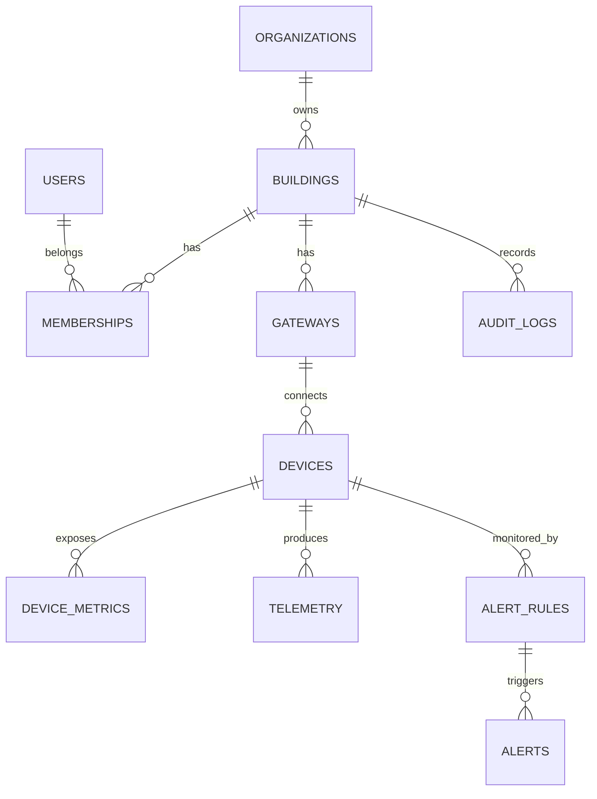

# Modelo de dados — Prédio ON

Este resumo descreve parte do schema existente. A [arquitetura de produto revisada](superpowers/specs/2026-09-27-arquitetura-produto-design.md) detalha as entidades atuais e propostas para unidades, equipes, RBAC, sessões, ativos, manutenção, automações, planos e filas. Essas novas entidades ainda não foram aplicadas ao banco.

## ERD simplificado

## Tabelas

| Tabela | Finalidade |
|---|---|
| `users` | Usuários da plataforma |
| `organizations` | Clientes/organizações |
| `buildings` | Prédios/condomínios |
| `memberships` | Vínculo e papel do usuário no prédio |
| `gateways` | Gateway físico instalado no prédio |
| `devices` | Sensores e monitores conectados |
| `device_metrics` | Métricas expostas por cada dispositivo |
| `ingest_events` | Idempotência da ingestão MQTT |
| `telemetry` | Série temporal de medições |
| `alert_rules` | Regras configuráveis de limite |
| `alerts` | Ocorrências geradas pelas regras |
| `audit_logs` | Auditoria de ações administrativas |

## Multi-tenancy

A coluna `building_id` é a principal fronteira de isolamento. A API aplica RBAC e o PostgreSQL usa RLS como segunda camada de segurança.

Na arquitetura de destino, cada condomínio/imóvel continua sendo o tenant operacional, identificado por `buildings.id`. `organizations` agrupa clientes comercialmente; esse agrupamento não deve conceder acesso operacional implícito aos demais condomínios. Identidades e catálogos globais, dados comerciais e dados do condomínio têm políticas de escopo distintas, descritas na arquitetura revisada.

## Telemetria

`telemetry` é transformada em hypertable do TimescaleDB, em blocos de 7 dias. O valor original fica em `value` e, quando numérico, também em `numeric_value` para consultas de limiar/agregação. `telemetry_series` (056) lista cada par condomínio/dispositivo/métrica já visto, sem valores; um gatilho o preenche na primeira leitura de cada série e a tela de últimas leituras consulta uma leitura por série.

### Capacidade e retenção (medido em 17/10/2026)

Medição com `db:telemetry-capacity` num cluster descartável (PostgreSQL 16, TimescaleDB 2.17.2, container de 1 GB): 50 dispositivos, uma leitura por minuto, 14 dias, **1.008.000 leituras**.

| Medida | Resultado |
| --- | --- |
| Espaço por leitura | **~532 bytes**: 180 de tabela e 352 de índices (oito índices; o maior, `telemetry_device_metric_time_idx`, 121 bytes) |
| Projeção | ~**0,26 GiB por dispositivo por ano** a uma leitura por minuto; um condomínio com 30 dispositivos a cada 5 minutos fica perto de 1,6 GiB/ano |
| Gravação em lote (uma instrução) | ~14 mil leituras/s, com e sem o gatilho da 056; a ingestão real grava mensagem a mensagem e é mais lenta |
| Últimas leituras (painel), papel da API com RLS | **268 ms** com o catálogo; **1.328 ms** com a consulta anterior (`DISTINCT ON` sobre 7 dias, ~504 mil linhas ordenadas) |
| Série de um dispositivo, 24 h em blocos de 5 min / 14 dias por hora | 106 ms / 129 ms |

Cerca de 100 ms de cada consulta vêm da autorização por linha (RLS) e não do volume. Os índices duplicados `telemetry_building_time_idx`/`telemetry_building_time_desc_idx` custam juntos ~23 bytes por leitura; ficaram como estão até um ensaio com a ingestão real.

**Compressão e agregados contínuos não estão disponíveis:** o TimescaleDB 2.17 recusa os dois em tabelas com RLS (`compression cannot be used on table with row security`, `cannot create continuous aggregate on hypertable with row security`), e a telemetria depende de RLS para o isolamento entre condomínios. O consumo diário já fica agregado em `daily_usage`, que não é afetado pela retenção.

**Retenção é opt-in e manual:** `pnpm db:telemetry-retention` mostra tamanho, blocos e período; `--months N --confirm` (mínimo 13 meses, para comparar o mesmo mês do ano anterior) instala a política do TimescaleDB, que apaga blocos inteiros mais antigos que N meses; `--off` volta a guardar tudo. Apagar leituras é irreversível, por isso nenhuma migration, seed ou serviço faz isso sozinho. Decidir o prazo é do proprietário; a sugestão do projeto desde a 001 é 24 meses.

## Idempotência

MQTT QoS 1 pode entregar a mesma mensagem mais de uma vez. Antes de gravar a série temporal, o ingest tenta registrar `event_id` em `ingest_events`; se o ID já existir, a mensagem duplicada é descartada.

## Alertas

As regras ficam em `alert_rules`, com operador, limiar, severidade e cooldown. Quando uma medição atende à condição, o sistema cria uma linha em `alerts`.

## Escala

A evolução prevista mantém o banco central e separa API, recepção IoT e workers por carga. A execução horizontal ainda exige validar deduplicação, reservas de trabalho, ordenação, pools de conexão e recuperação; o cliente MQTT fixo atual não pode ser replicado sem adaptação. TimescaleDB organiza o histórico temporal; os números medidos de espaço e de consulta estão em [Capacidade e retenção](#capacidade-e-retenção-medido-em-17102026). Falta um ensaio de carga com a ingestão real (MQTT mensagem a mensagem).
