# Imagens reais dos aplicativos e portais

Publicadas em **03/10/2026**, atualizadas em **04/10/2026**. Estas capturas foram conferidas em execuções reais e usam dados fictícios. Cada imagem mantém a origem comprovada, inclusive commit nulo quando o runtime não foi atestado; a data de publicação não altera a versão demonstrada. O plano completo e os cinco vídeos finais continuam pendentes, conforme [CONTINUIDADE.md](CONTINUIDADE.md).

As **32 imagens — 9 Android, 17 web e 6 iOS** — e a [galeria HTML](IMAGENS_DOS_SISTEMAS.html) acompanham o clone. As seis iOS incluem duas capturas históricas de b4726b9, duas de novo processo Release em deb20b1 e duas em6298065; todas mostram somente entrada. Abra a galeria no navegador para filtrar e ampliar. O [manifesto](imagens/2026-10-03/manifesto.json) registra dimensões, SHA-256 e origem. As referências desta atualização foram conferidas estaticamente; o acesso ao servidor local 8765 continua bloqueado, sem novo aceite dos controles no navegador.

## Android — Morador: avisos

Origem: [`f622949`](https://github.com/helberjf/predioON/commit/f62294935cc3005b5bc1bd287831bf48a2fb1276). Emulador Android com API/banco de teste; homologação em aparelho e todos os domínios continuam pendentes.

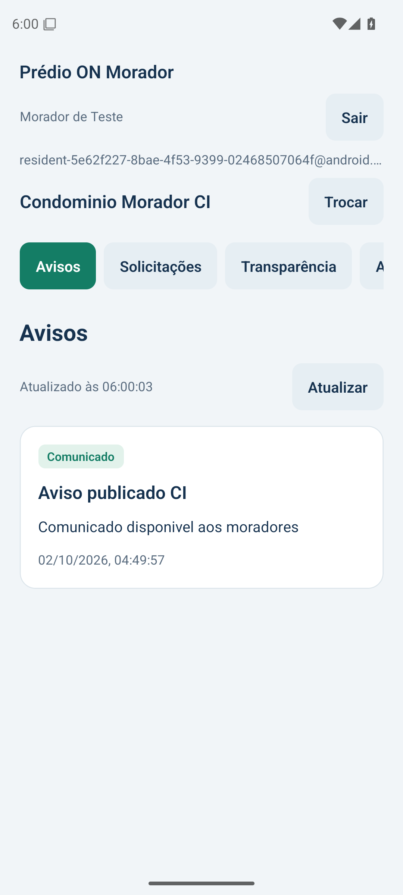

## Android — Morador: reserva confirmada

Origem: [`42f2130`](https://github.com/helberjf/predioON/commit/42f2130ac35fc15043c3b4f0fc8d1dbda7b06a24). Emulador Android com API/banco de teste; homologação em aparelho e todos os domínios continuam pendentes.

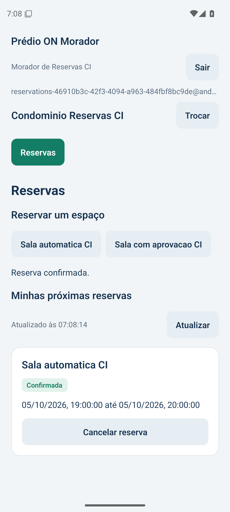

## Android — Operação: resumo

Origem: [`f622949`](https://github.com/helberjf/predioON/commit/f62294935cc3005b5bc1bd287831bf48a2fb1276). Emulador Android com API/banco de teste; homologação em aparelho e todos os domínios continuam pendentes.

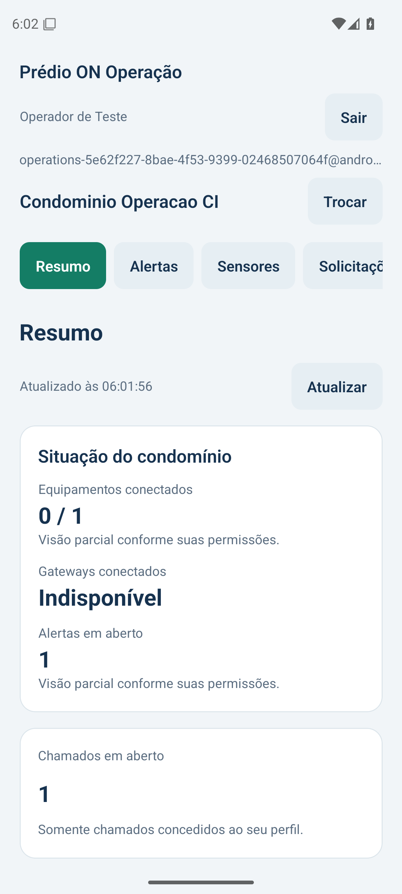

## Web — Administração

Origem: [`5eda20e`](https://github.com/helberjf/predioON/commit/5eda20e9778593ead30a2334a494570e6720eddb). Captura web de Chromium com API real e banco descartável; não comprova funcionalidades posteriores.

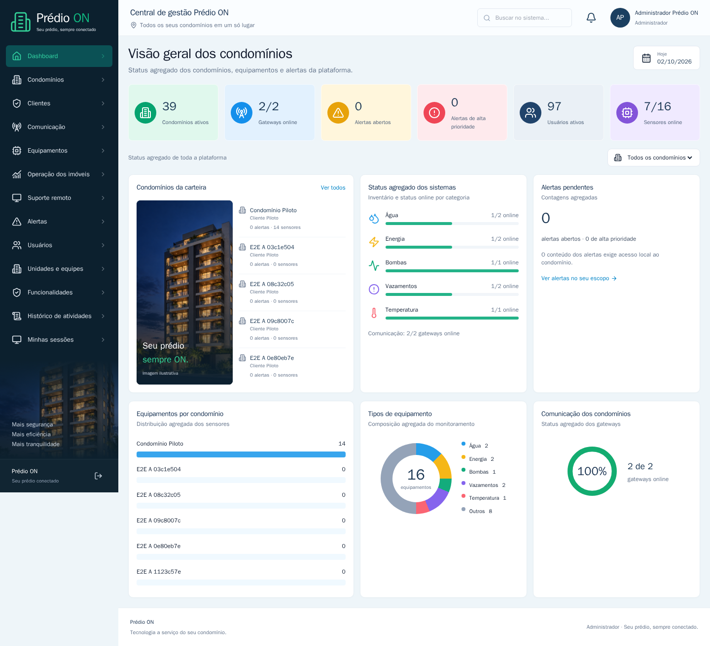

## Web — Síndico

Origem: [`5eda20e`](https://github.com/helberjf/predioON/commit/5eda20e9778593ead30a2334a494570e6720eddb). Captura web de Chromium com API real e banco descartável; não comprova funcionalidades posteriores.

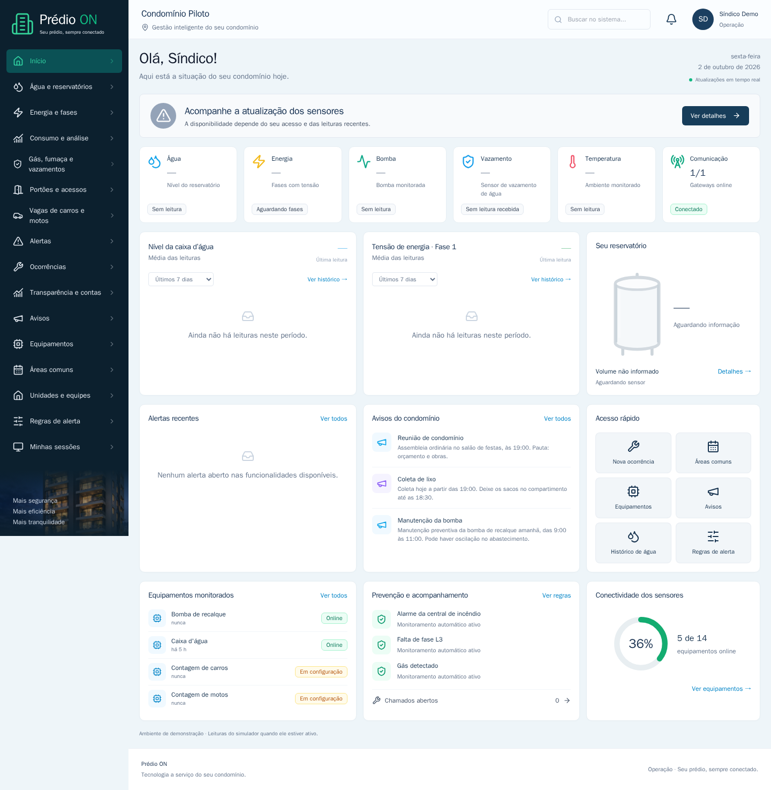

## Web — Morador

Origem: [`5eda20e`](https://github.com/helberjf/predioON/commit/5eda20e9778593ead30a2334a494570e6720eddb). Captura web de Chromium com API real e banco descartável; não comprova funcionalidades posteriores.

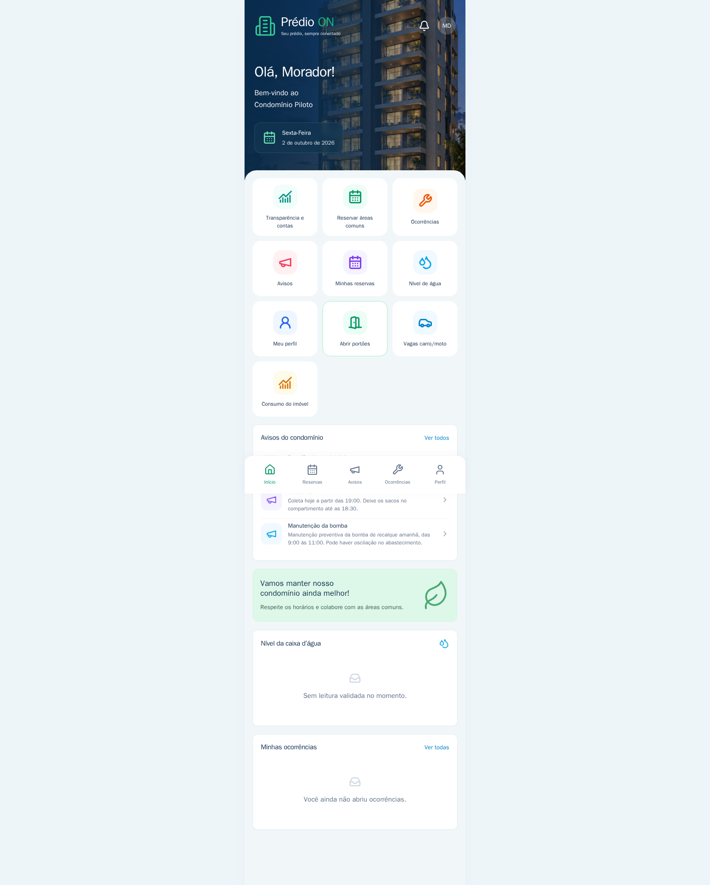

## iOS — Morador: entrada

Origem: [`b4726b9`](https://github.com/helberjf/predioON/commit/b4726b97c7a1384d836ec84a8c265fe002bd951e). Inicialização e novo processo em iPhone 16 Pro/iOS 18.5; login e jornadas autenticadas ainda pendentes.

## iOS — Operação: entrada

Origem: [`b4726b9`](https://github.com/helberjf/predioON/commit/b4726b97c7a1384d836ec84a8c265fe002bd951e). Inicialização e novo processo em iPhone 16 Pro/iOS 18.5; login e jornadas autenticadas ainda pendentes.

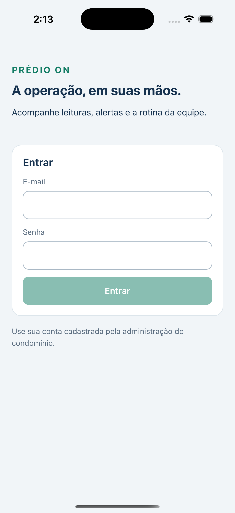

## Web — Auditoria global

Origem: [`c2871f0`](https://github.com/helberjf/predioON/commit/c2871f0b1fd9c9039bb5240100b256841df8bd12). Histórico autorizado da plataforma, sem metadata, IP ou user-agent. Captura real de Chromium com API036 e banco descartável; dados fictícios. A fonte dos16 arquivos testados foi conferida contra este commit; a captura local precedeu sua publicação, com os mesmos arquivos.

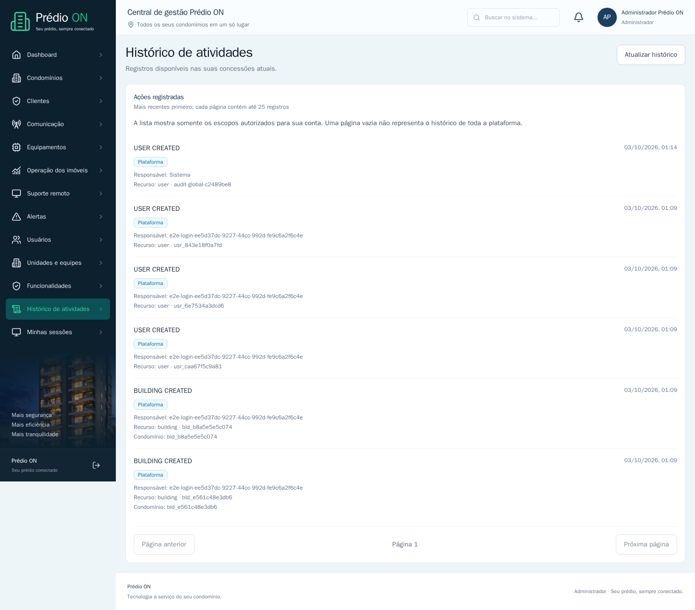

## Web — Auditoria do condomínio

Origem: [`c2871f0`](https://github.com/helberjf/predioON/commit/c2871f0b1fd9c9039bb5240100b256841df8bd12). Histórico local com25 registros por página e viewport390px. É o portal web responsivo, com API036 real; não é uma captura nativa de Android ou iOS. A fonte dos16 arquivos testados foi conferida contra este commit; a captura local precedeu sua publicação, com os mesmos arquivos.

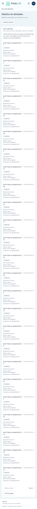

## Android — Morador · Contas publicadas

Origem: [8408a5d](https://github.com/helberjf/predioON/actions/runs/37130882267), artefato11276742968, APK release x86_64 com API/PostgreSQL reais e dados fictícios. Prestação publicada com total e acesso aos lançamentos. Fase04 aprovada; percurso completo falhou mais tarde na revogação da Operação. Esta captura parcial não homologa toda a jornada nem aparelho físico.

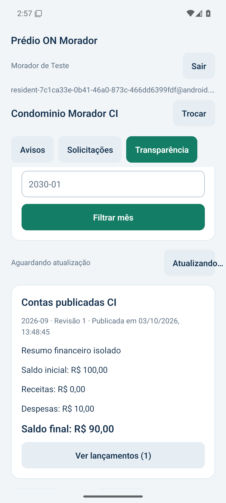

## Android — Operação · Alerta reconhecido

Origem: [8408a5d](https://github.com/helberjf/predioON/actions/runs/37130882267), artefato11276742968, APK release x86_64 com API/PostgreSQL reais e dados fictícios. Reconhecimento confirmado na interface e nas provas de ações do banco. Fase06 aprovada; percurso completo falhou mais tarde na verificação de conteúdo revogado. Esta captura parcial não homologa toda a jornada nem aparelho físico.

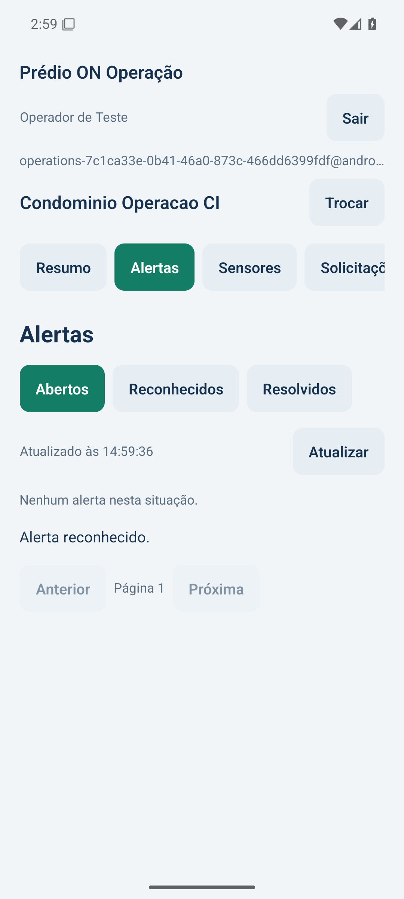

## Web — Administração · Segurança da conta

Fonte037 [057722b](https://github.com/helberjf/predioON/commit/057722bd61d3466516e5eb0eec8527c485fdd5b9), com23 arquivos comparados por SHA-256 LF. Formulário real com campos vazios protegidos, confirmação e cancelamento. API/PostgreSQL reais, contas fictícias isoladas e captura revisada; não é gravação final. A matriz funcional separada passou222/222 nos três motores, sem retries. No Morador, a rolagem nativa deixa o formulário inteiro acima da navegação fixa; nenhum elemento foi removido ou alterado para a imagem.

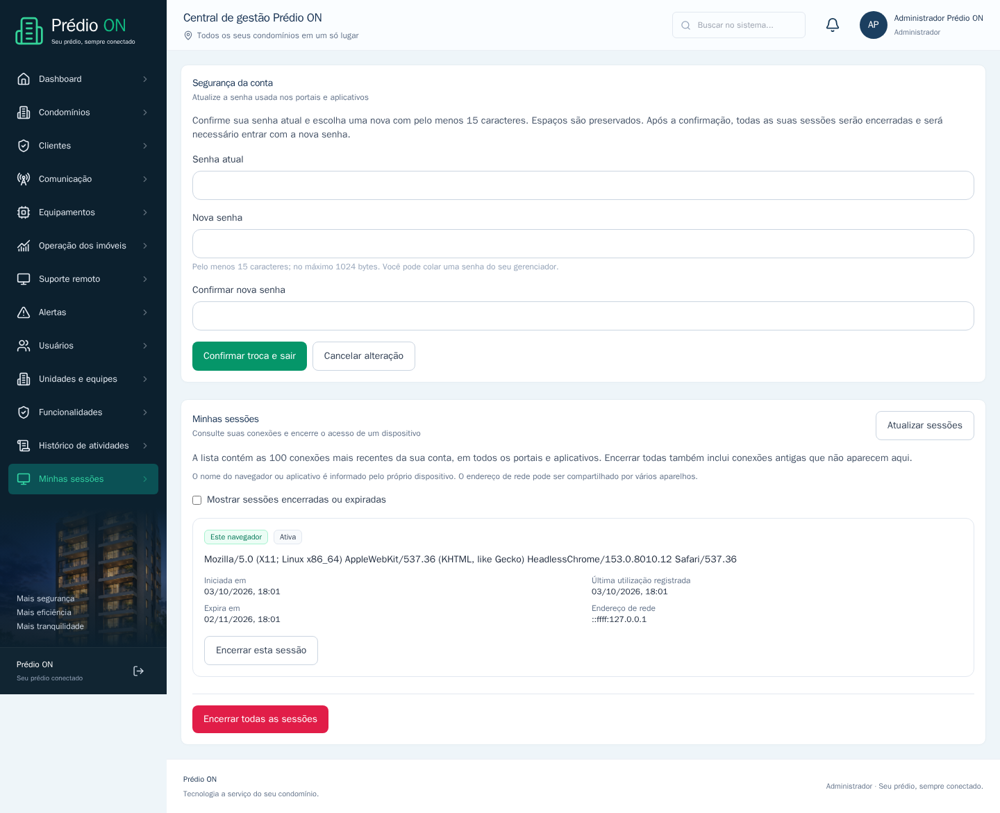

## Web — Síndico · Segurança da conta

Fonte037 [057722b](https://github.com/helberjf/predioON/commit/057722bd61d3466516e5eb0eec8527c485fdd5b9), com23 arquivos comparados por SHA-256 LF. Formulário real com campos vazios protegidos, confirmação e cancelamento. API/PostgreSQL reais, contas fictícias isoladas e captura revisada; não é gravação final. A matriz funcional separada passou222/222 nos três motores, sem retries. No Morador, a rolagem nativa deixa o formulário inteiro acima da navegação fixa; nenhum elemento foi removido ou alterado para a imagem.

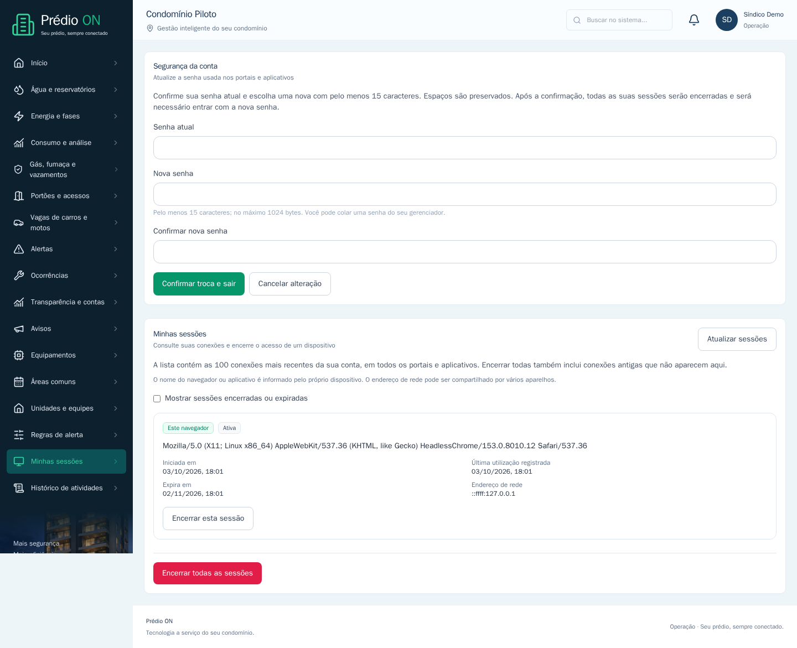

## Web — Morador · Segurança da conta

Fonte037 [057722b](https://github.com/helberjf/predioON/commit/057722bd61d3466516e5eb0eec8527c485fdd5b9), com23 arquivos comparados por SHA-256 LF. Formulário real com campos vazios protegidos, confirmação e cancelamento. API/PostgreSQL reais, contas fictícias isoladas e captura revisada; não é gravação final. A matriz funcional separada passou222/222 nos três motores, sem retries. No Morador, a rolagem nativa deixa o formulário inteiro acima da navegação fixa; nenhum elemento foi removido ou alterado para a imagem.

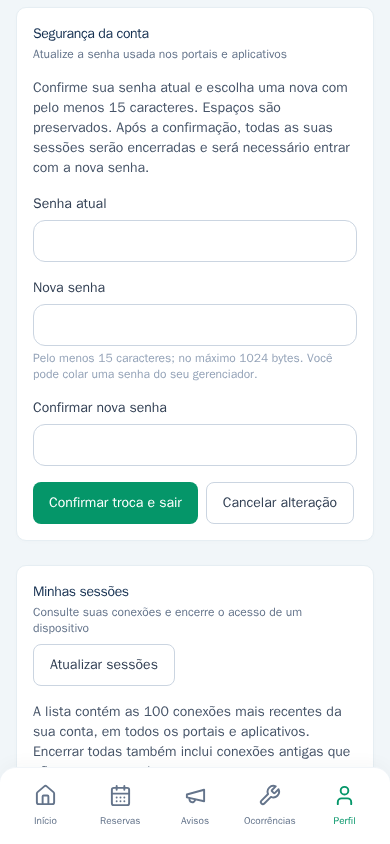

## Web — Síndico · Prestação publicada

Captura manual real no navegador desta máquina, API e banco demonstrativo com37 migrations. Rascunho privado e publicação foram verificados entre Síndico e Morador; saldo inicial R$123,45 menos despesa R$23,45 resultou R$100,00. Dados exclusivamente fictícios, sem pagamento real. Fonte [580a236](https://github.com/helberjf/predioON/commit/580a23608f4f79df3f9728946be4bfdb993155bb), com198 arquivos de runtime comparados ao commit e hashes dos bundles no [registro](imagens/2026-10-03/web-finance-manual-evidence.json). O screenshot retornou JPEG; bytes preservados, sem conversão ou edição. Viewport real1280×720, captura da página inteira; não é teste de390px nem app nativo.

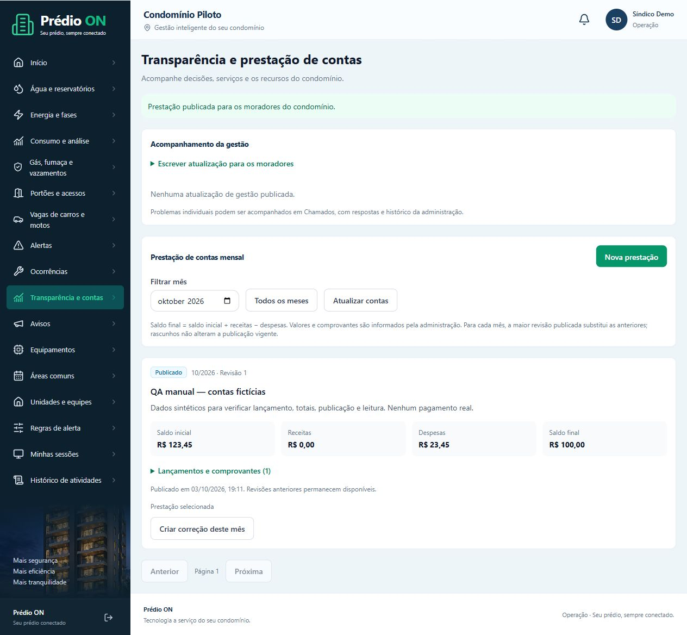

## Web — Morador · Prestação publicada

Captura manual real no navegador desta máquina, API e banco demonstrativo com37 migrations. Rascunho privado e publicação foram verificados entre Síndico e Morador; saldo inicial R$123,45 menos despesa R$23,45 resultou R$100,00. Dados exclusivamente fictícios, sem pagamento real. Fonte [580a236](https://github.com/helberjf/predioON/commit/580a23608f4f79df3f9728946be4bfdb993155bb), com198 arquivos de runtime comparados ao commit e hashes dos bundles no [registro](imagens/2026-10-03/web-finance-manual-evidence.json). O screenshot retornou JPEG; bytes preservados, sem conversão ou edição. Viewport real1280×720, captura da página inteira; não é teste de390px nem app nativo.

## Android — Morador · Segurança da conta

Origem: [CI1f7bd3d](https://github.com/helberjf/predioON/actions/runs/37157034870), artefato11285664020, APK Release x86_64 com assinatura efêmera de teste. Minha conta com campos protegidos vazios e confirmação desabilitada. 29 fases por app aprovadas contra API/PG/HTTPS reais: erro400 preserva sessão, troca204 revoga as próprias famílias, senha antiga401, nova literal200 e isolamento entre apps. É captura nativa de emulador Release, sem edição; aparelho físico e iOS autenticado pendentes. Um aviso MissingViewState permanece na jornada de senha da Operação; não houve crash/ANR. Hashes de imagem/APK e resultado no [registro](imagens/2026-10-03/android-password-evidence.json).

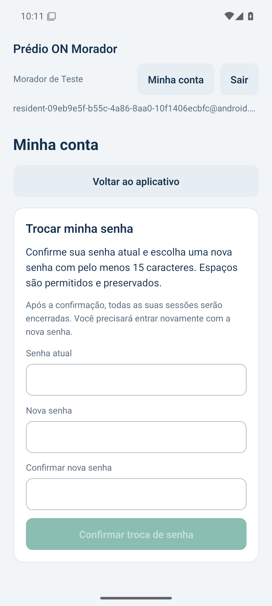

## Android — Operação · Segurança da conta

Origem: [CI1f7bd3d](https://github.com/helberjf/predioON/actions/runs/37157034870), artefato11285664020, APK Release x86_64 com assinatura efêmera de teste. Minha conta com campos protegidos vazios e confirmação desabilitada. 29 fases por app aprovadas contra API/PG/HTTPS reais: erro400 preserva sessão, troca204 revoga as próprias famílias, senha antiga401, nova literal200 e isolamento entre apps. É captura nativa de emulador Release, sem edição; aparelho físico e iOS autenticado pendentes. Um aviso MissingViewState permanece na jornada de senha da Operação; não houve crash/ANR. Hashes de imagem/APK e resultado no [registro](imagens/2026-10-03/android-password-evidence.json).

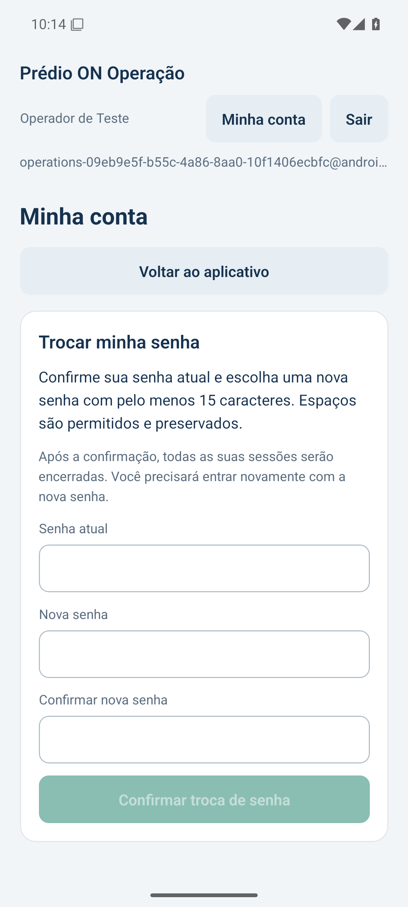

## iOS — Morador · Novo processo Release · Entrada

Origem: [deb20b1, startup 37210946972](https://github.com/helberjf/predioON/actions/runs/37210946972), artefato 11306358477, fase `02-new-process`. Build Release assinado localmente para simulador iOS 18.5/SDK18.5. Primeira abertura, sobrevivência de 15 s, encerramento e abertura com outro PID foram conferidos; formulário com E-mail/Senha vazios e Entrar. Os 73/73 testes host deste job, digest do ZIP, resultado e duas imagens de origem foram verificados. Esta é a captura original do segundo processo, copiada sem edição; [registro público dos hashes e limites](evidencias/ios-deb20b1.json). Comprova entrada/inicialização, sem login, restauração de sessão pelo Keychain, XCTest ou domínios. O ensaio autenticado da mesma fonte falhou na instalação dos Pods, antes de prontidão HTTPS/XCTest.

## iOS — Operação · Novo processo Release · Entrada

Origem: [deb20b1, startup 37210946972](https://github.com/helberjf/predioON/actions/runs/37210946972), artefato 11306851591, fase `02-new-process`. Build Release assinado localmente para simulador iOS 18.5/SDK18.5. Primeira abertura, sobrevivência de 15 s, encerramento e abertura com outro PID foram conferidos; formulário com E-mail/Senha vazios e Entrar. Os 73/73 testes host deste job, digest do ZIP, resultado e duas imagens de origem foram verificados. Esta é a captura original do segundo processo, copiada sem edição; [registro público dos hashes e limites](evidencias/ios-deb20b1.json). Comprova entrada/inicialização, sem login, restauração de sessão pelo Keychain, XCTest ou domínios. O ensaio autenticado da mesma fonte falhou na instalação dos Pods, antes de prontidão HTTPS/XCTest.

## Web — Morador · Chamado criado

Formulário vazio bloqueado pela validação required do navegador; chamado fictício #1000 criado pelo Morador com prioridade Baixa, categoria Outros e histórico Abertura. QA manual parcial em navegador desta máquina, com Morador Demo/Condomínio Piloto e banco demonstrativo de 37 migrations. As fontes das sete raízes comparadas são idênticas entre 580a236 e 1414f020; os bundles JS atuais de dist diferem da prova histórica de 580a236. Hashes atuais, comparação e ações observadas estão no registro. O commit carregado pelo processo API e os bytes efetivamente servidos ao navegador não foram comprovados; esta captura não demonstra runtime038, apps nativos, produção, cobertura completa ou vídeo. JPEG original, sem edição ou conversão. [Registro e limites](imagens/2026-10-03/web-occurrences-manual-evidence.json).

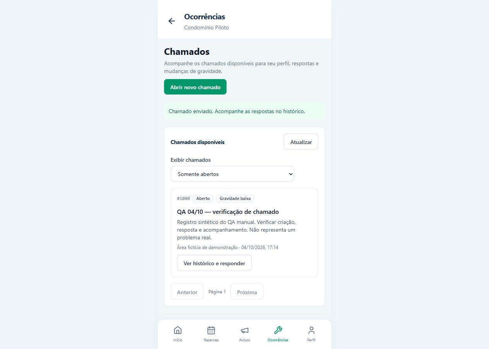

## Web — Síndico · Chamado resolvido

Resposta ao chamado fictício #1000 enviada pelo Síndico e estado resolvido conferido no portal do condomínio. QA manual parcial em navegador desta máquina, com Morador Demo/Condomínio Piloto e banco demonstrativo de 37 migrations. As fontes das sete raízes comparadas são idênticas entre 580a236 e 1414f020; os bundles JS atuais de dist diferem da prova histórica de 580a236. Hashes atuais, comparação e ações observadas estão no registro. O commit carregado pelo processo API e os bytes efetivamente servidos ao navegador não foram comprovados; esta captura não demonstra runtime038, apps nativos, produção, cobertura completa ou vídeo. JPEG original, sem edição ou conversão. [Registro e limites](imagens/2026-10-03/web-occurrences-manual-evidence.json).

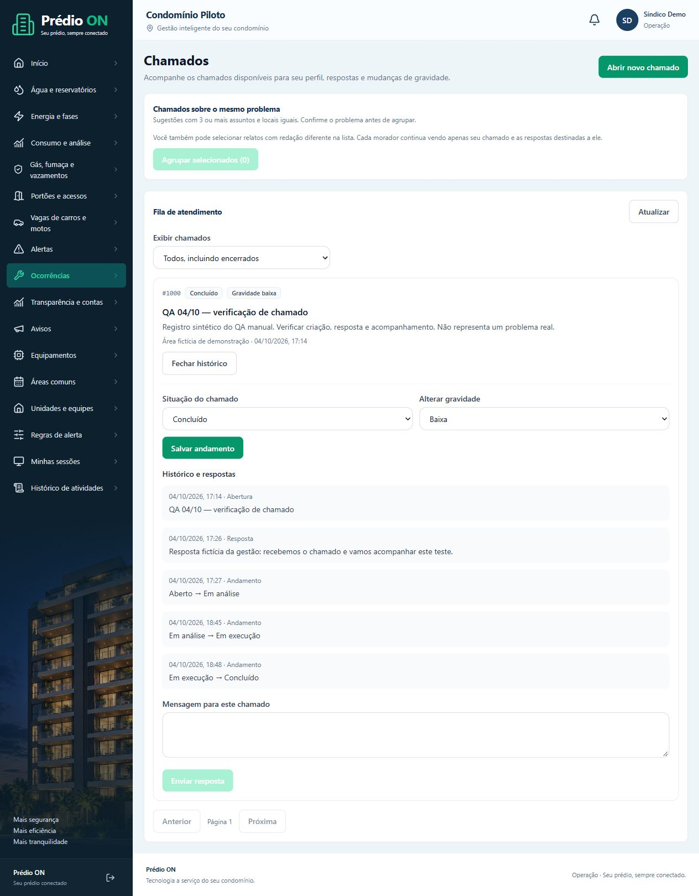

## Web — Morador · Chamado resolvido

Após atualização no Morador, o chamado fictício #1000 aparece resolvido. Resposta e histórico de resolução também foram conferidos. QA manual parcial em navegador desta máquina, com Morador Demo/Condomínio Piloto e banco demonstrativo de 37 migrations. As fontes das sete raízes comparadas são idênticas entre 580a236 e 1414f020; os bundles JS atuais de dist diferem da prova histórica de 580a236. Hashes atuais, comparação e ações observadas estão no registro. O commit carregado pelo processo API e os bytes efetivamente servidos ao navegador não foram comprovados; esta captura não demonstra runtime038, apps nativos, produção, cobertura completa ou vídeo. JPEG original, sem edição ou conversão. [Registro e limites](imagens/2026-10-03/web-occurrences-manual-evidence.json).

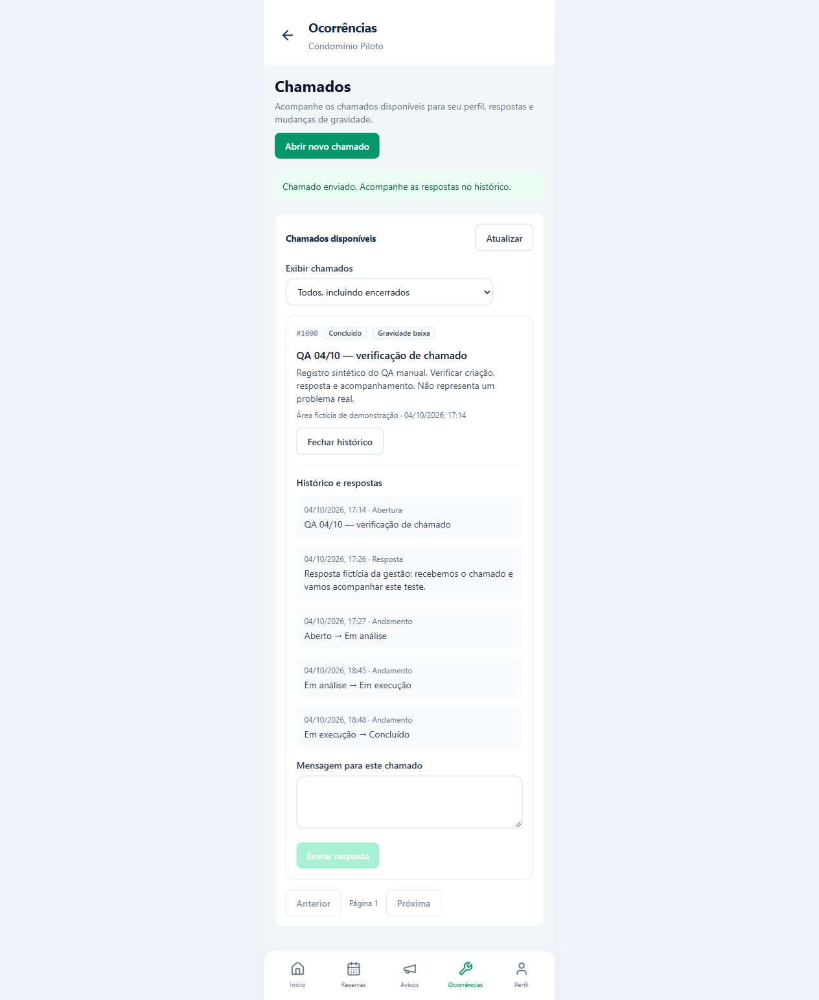

## Web — Morador · Reserva pendente

Reserva sintética de churrasqueira enviada pelo Morador para aprovação da gestão. Dados fictícios, QA manual parcial em demo037. API em execução e bundles servidos sem commit comprovado; fontes e hashes locais comparados no registro. JPEG original, sem edição. Não comprova todos os conflitos, privacidade de terceiros, apps nativos, produção ou vídeo. [Registro e limites](imagens/2026-10-03/web-reservations-manual-evidence.json).

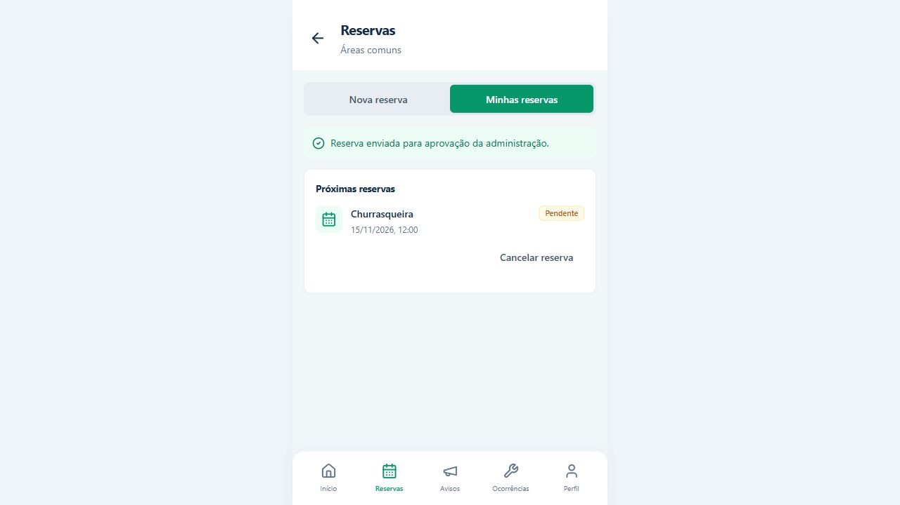

## Web — Síndico · Reserva aprovada

A gestão aprovou a reserva; ela saiu da fila de pendências e apareceu como confirmada. O Morador também conferiu a confirmação após recarregar. Dados fictícios, QA manual parcial em demo037. API em execução e bundles servidos sem commit comprovado; fontes e hashes locais comparados no registro. JPEG original, sem edição. Não comprova todos os conflitos, privacidade de terceiros, apps nativos, produção ou vídeo. [Registro e limites](imagens/2026-10-03/web-reservations-manual-evidence.json).

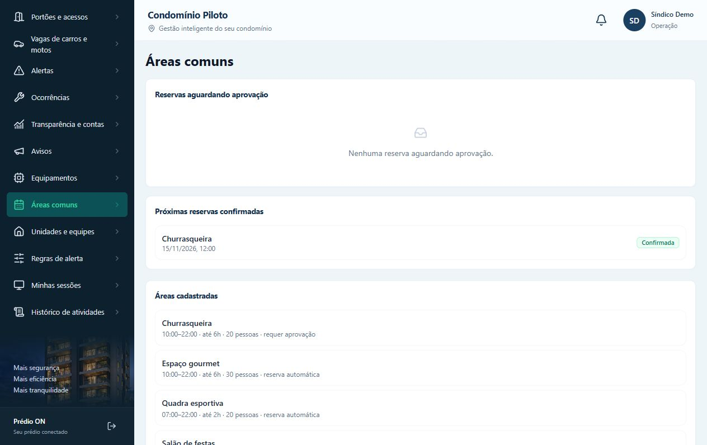

## Web — Morador · Reserva cancelada

O próprio Morador cancelou a reserva confirmada. O botão de cancelamento desapareceu e as filas de pendências/confirmadas da gestão ficaram vazias após recarregar. Dados fictícios, QA manual parcial em demo037. API em execução e bundles servidos sem commit comprovado; fontes e hashes locais comparados no registro. JPEG original, sem edição. Não comprova todos os conflitos, privacidade de terceiros, apps nativos, produção ou vídeo. [Registro e limites](imagens/2026-10-03/web-reservations-manual-evidence.json).

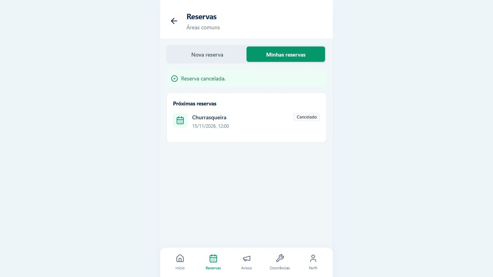

## Android — Morador · Reserva confirmada · a34346b

Reserva própria confirmada na fase09-confirmed, após criação pelo Morador. Snapshot confirmed: uma própria CONFIRMED, um registro de criação, nenhuma própria cancelada. APK Release x86_64, API/PostgreSQL/HTTPS reais e dados fictícios. Fonte a34346b, run37239139329, artefato11317006586. Jornada de reservas23 observações e oito snapshots do banco conferidos; PNG original extraído sem edição e revisado visualmente. Estas fases funcionais não aprovam a comparação do renderer: os dois gates da candidata pararam antes do PID. Homologação física, produção e vídeos finais continuam pendentes. [Prova fechada, hashes e limites](evidencias/android-a34346b.json). SHA da imagem: `850c783bb50ee15f58b4b369b3847235ecb2a2a44245d9c1f41b91dbdab5840e`.

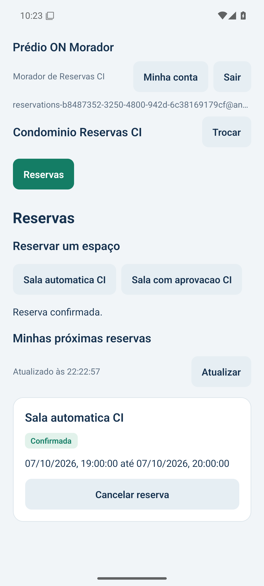

## Android — Morador · Reserva cancelada · a34346b

Reserva própria cancelada na fase13-cancelled. Snapshot cancelled: uma própria CANCELLED, nenhuma própria CONFIRMED e um registro de cancelamento; a reserva de outro condomínio mantém CONFIRMED. APK Release x86_64, API/PostgreSQL/HTTPS reais e dados fictícios. Fonte a34346b, run37239139329, artefato11317006586. Jornada de reservas23 observações e oito snapshots do banco conferidos; PNG original extraído sem edição e revisado visualmente. Estas fases funcionais não aprovam a comparação do renderer: os dois gates da candidata pararam antes do PID. Homologação física, produção e vídeos finais continuam pendentes. [Prova fechada, hashes e limites](evidencias/android-a34346b.json). SHA da imagem: `113b83622e8ba1caed2aefd9c7c4ca8c3d805f5276dc15a98cbb1bb2f6887444`.

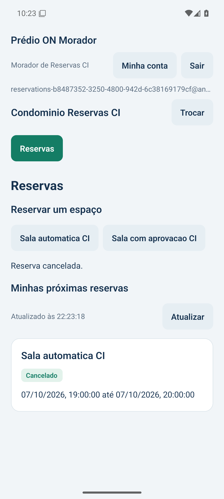

## iOS — Morador · Novo processo Release · 6298065

Formulário E-mail/Senha vazio no segundo processo Release, simulador iOS18.5/SDK18.5. Abertura, sobrevivência e novo processo dos dois produtos conferidos. PNG original da fase02-new-process, copiada sem edição e revisada visualmente pelo agente principal. Fonte6298065, startup37240428244; a execução autenticada37240428231 falhou no build do runner, diagnostic runner-build/nonzero-exit/70, antes de test-without-building. Entrada não aprova login, Keychain/famílias,14POSTs, domínios, distribuição, aparelhos físicos ou produção; zero checkpoints aprovados não prova ausência de pedidos antes da falha. Artefato11316892273; [prova fechada e hashes](evidencias/ios-6298065.json).

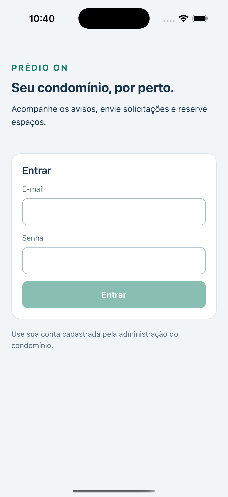

## iOS — Operação · Novo processo Release · 6298065

Formulário E-mail/Senha vazio no segundo processo Release, simulador iOS18.5/SDK18.5. Abertura, sobrevivência e novo processo dos dois produtos conferidos. PNG original da fase02-new-process, copiada sem edição e revisada visualmente pelo agente principal. Fonte6298065, startup37240428244; a execução autenticada37240428231 falhou no build do runner, diagnostic runner-build/nonzero-exit/70, antes de test-without-building. Entrada não aprova login, Keychain/famílias,14POSTs, domínios, distribuição, aparelhos físicos ou produção; zero checkpoints aprovados não prova ausência de pedidos antes da falha. Artefato11317101666; [prova fechada e hashes](evidencias/ios-6298065.json).

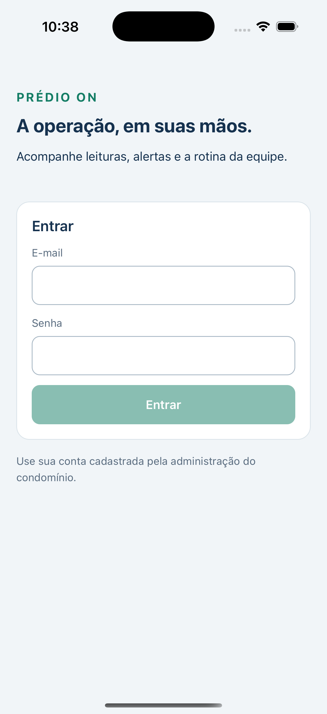

## Web — Síndico: menu móvel corrigido

Menu do Síndico em375×812 após reconstruir os portais da fontebc2fcc8. Foco inicial, cicloTab/ShiftTab, Escape, página atual e transição desktop conferidos no navegador; Playwright240/240,80por motor, sem retries/skips. JPEG original revisado, dados fictícios da demo037. A origem atesta somente fontes front-end; API carregada e bytes do navegador em memória não foram capturados. Não é homologação integral ou vídeo. [Prova e hashes](evidencias/web-menu-bc2fcc8.json).

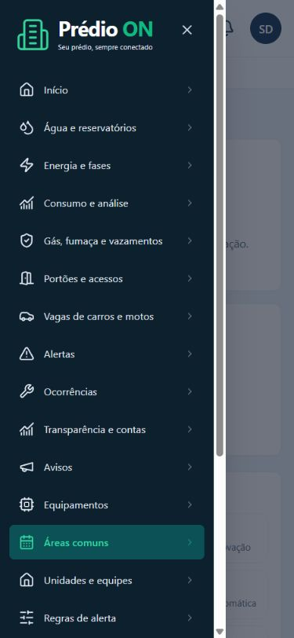
