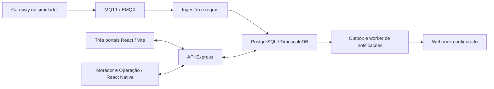

# Prédio ON: roteiro para entrevistas e apresentações

Versão de trabalho de 05/11/2026. Este roteiro explica a arquitetura e os fluxos
presentes no projeto. O aceite final dos apps, MFA obrigatória, infraestrutura e
gravações atuais continua no [arquivo de continuidade](CONTINUIDADE.md). Confira-o
antes de apresentar números de testes ou afirmar que um recurso está homologado.
Para abrir o ambiente, consulte [COMO_ABRIR_OS_SISTEMAS.md](COMO_ABRIR_OS_SISTEMAS.md).

## Abertura: 30 segundos

“O Prédio ON reúne a operação de um condomínio e as informações de seus
equipamentos. O síndico acompanha água, energia, alertas, manutenção e convivência.
O morador acessa seus avisos, solicitações e reservas. A equipe de operação usa
um aplicativo próprio. Uma API aplica as permissões de cada pessoa e integra
essas interfaces às leituras recebidas do campo.”

## Apresentação de 8 a 10 minutos

| Tempo | O que mostrar | O que explicar |
| --- | --- | --- |
| 0–1 min | Visão geral do condomínio | Quem usa o produto e quais problemas ele organiza. Identificar explicitamente se o ambiente e os sensores são simulados. |
| 1–3 min | Portal do condomínio: sensores, alertas e manutenção | Uma leitura chega, uma regra pode gerar alerta e a equipe acompanha a ação. Mostrar horário, qualidade e ausência de dados; não inventar leitura quando o sensor está indisponível. |
| 3–4 min | Portal/app Morador: aviso, solicitação ou reserva | Mostrar uma jornada completa permitida à conta: criar, confirmar o resultado e consultar novamente. Usar dados fictícios. |
| 4–5 min | App Operação: alerta e ordem de serviço | Explicar a separação de públicos e executar somente ações autorizadas no ambiente de demonstração. |
| 5–6 min | Administração: condomínio, funcionalidades e suporte | Configuração da plataforma não significa acesso irrestrito aos dados de todos os condomínios. O suporte depende de concessão, escopo e prazo. |
| 6–8 min | Diagrama e uma evidência de teste | Explicar o caminho dos dados, as fronteiras de autorização e um caso negativo realmente executado. |
| 8–10 min | Decisões e próximos passos | Diferenciar o que foi implementado, o que foi testado na fonte atual e o que ainda exige aparelho, hardware ou infraestrutura externa. |

Não é necessário percorrer todas as telas nessa apresentação curta. Para uma
demonstração funcional mais longa, use o [roteiro comercial](ROTEIRO_DEMONSTRACAO.md),
conferindo primeiro quais serviços e cenários estão disponíveis. Comandos remotos
desse roteiro não fazem parte da abertura local.

## Os cinco produtos que o público vê

| Produto | Público e função | Limite a explicar |
| --- | --- | --- |
| Administração web | Gestão da plataforma, clientes/condomínios, funcionalidades e suporte | Privilégios da plataforma e concessões de suporte são decisões diferentes. |
| Condomínio web | Síndico/gestão: monitoramento, alertas, convivência, manutenção e transparência | Módulos e ações dependem da configuração e das capacidades concedidas. |
| Morador web | Entrada pública, avisos, solicitações, reservas e informações publicadas | O morador não recebe dados operacionais privados por usar outra largura de tela. |
| Morador Android/iOS | Experiência nativa do morador, incluindo acesso autorizado e QR quando habilitados | Câmera e comportamento do aparelho exigem teste nativo. |
| Operação Android/iOS | Sensores, alertas, solicitações e ordens de serviço da equipe | Não há app nativo de administração da plataforma; os dois apps não são cópias de um navegador. |

O inventário detalhado está em [FUNCIONALIDADES.md](FUNCIONALIDADES.md) e no
[guia mobile](../packages/mobile/README.md). As telas disponíveis variam com a
conta, o condomínio, a concessão e as funcionalidades ativas.

## Como explicar a arquitetura

“As interfaces usam contratos e um cliente HTTP compartilhados. Elas não acessam
diretamente o banco nem o broker. A ingestão trata a chegada de leituras; a API
atende as ações de pessoas. PostgreSQL guarda os dados e aplica políticas de
acesso, enquanto TimescaleDB apoia as séries temporais. Eventos SSE atualizam
os portais. Os aplicativos nativos têm seu próprio ciclo de atualização e de
entrada em segundo plano.”

Uma notificação externa é um trabalho registrado de forma durável. O worker
usa uma conexão restrita e trata tentativas de entrega. Não prometer entrega
“exatamente uma vez” ao provedor: resposta perdida pode deixar um resultado
ambíguo. Consulte o [contrato de notificações](NOTIFICACOES_DURAVEIS.md).

## Perguntas técnicas e respostas que você pode adaptar

**Como um condomínio fica separado de outro?**

“A API verifica a identidade, o recurso e a capacidade solicitada. O contexto
da transação chega ao PostgreSQL, onde políticas RLS e papéis restritos limitam
o acesso. Esconder um botão ajuda a experiência, mas não é a autorização.
Testamos também chamadas negadas e concessões para recursos específicos.”

**Como funciona a sessão?**

“Usamos access token e refresh rotativo. A renovação é serializada no cliente,
e respostas antigas não devem recuperar uma sessão encerrada. No mobile, o
refresh token fica no armazenamento seguro do sistema. A integração da MFA
obrigatória para administradores está em validação; o checkpoint registra
separadamente o código candidato e o runtime publicado.”

**Por que separar ingestão e API?**

“Leituras de equipamentos e ações humanas têm ritmos, permissões e falhas
diferentes. Separá-las permite restringir as conexões e testar cada fluxo.
A persistência e os contratos continuam coordenados; não é uma promessa de
escala ilimitada ou de alta disponibilidade já homologada.”

**O que acontece quando a conexão cai?**

“As telas mostram a falha e revalidam dados. Uma ação que modifica dados não é
repetida indiscriminadamente. Nos comandos de acesso, uma intenção tem um
identificador próprio e o sistema distingue envio de confirmação do controlador.
Essa confirmação não mede a posição física do portão.”

**Como você demonstra qualidade?**

“Mostro a fonte exata e o resultado: testes de regras, banco real isolado,
permissões, concorrência e navegador. Um teste de interface com API simulada
não prova a integração com PostgreSQL; um teste React Native não prova câmera
ou instalação em iPhone. Cada evidência declara esse limite.”

**Qual foi um problema concreto de engenharia?**

“Uma permissão pode mudar enquanto uma conexão SSE está aberta. Não basta
validar o login uma vez. Os testes candidatos de MFA exercitam a mudança de
autoridade durante a projeção do evento e conferem o que a conexão entrega.
Nos equipamentos também precisamos preservar uma rechecagem posterior, porque
o suporte pode expirar entre a classificação do dispositivo e a entrega.”

Use o [registro dos testes de alertas](evidencias/mfa-alert-events-2026-11-05.json)
como exemplo executado. O recorte de status de dispositivos também tem [nove testes dirigidos aprovados](evidencias/mfa-device-events-2026-11-05.json). Gateway, heartbeat e integração completa continuam pendentes; o resultado desse recorte não aprova todos os eventos ou o rollout.

**Quais decisões você mudaria com mais tempo?**

Escolha uma melhoria do [backlog](MELHORIAS_E_EVOLUCOES.md), explique o problema,
o custo e a prova de sucesso desejada. Planos/assinaturas, homologação de campo
e evolução preditiva não devem ser apresentados como entregues. Push mobile
ficou fora do escopo por decisão do proprietário.

## O que registrar antes da apresentação final

- Commit exibido, ambiente utilizado e perfis de demonstração.
- Jornada executada por produto e resultado observado, incluindo recarregar a
  tela para conferir persistência e um caso de permissão ou validação.
- Fonte, data e limites das evidências de testes apresentadas.
- Capturas e vídeos atuais, sem senhas, tokens, segredo TOTP ou códigos de
  recuperação. O material histórico de 18/10 não comprova a versão atual.
- Limitações restantes e próximos passos, sem declarar aprovação de produção
  enquanto os critérios do [plano total](PLANO_TOTAL.md) estiverem abertos.

Para falar da própria participação, descreva o que você de fato decidiu,
implementou e verificou. A existência do repositório não demonstra autoria
individual de todas as mudanças; explique também como revisou contribuições
e ferramentas usadas no desenvolvimento.
